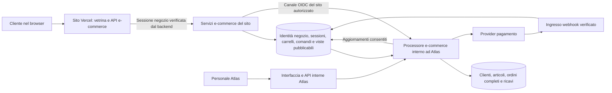

# E-commerce del sito — progetto di integrazione con Atlas

Versione 15 · 5 novembre 2026 · Stato: codice dei passi 2–13 predisposto; configurazione e collaudo delegati all’utente.

Il [passo 8](ecommerce-carrello-riepilogo.md) aggiunge carrelli/riepiloghi, configurazione consegna e attestazioni personali. Il [passo 9](ecommerce-ordini-ricavi.md) aggiunge conferma atomica, ordine e ricavo programmato. Il [passo 10](ecommerce-pagamenti-stripe.md) predispone Checkout ospitato, incassi verificati, rimborsi e UI Pagamenti di Atlas. Il [passo 11](ecommerce-consegne-eventi.md) aggiunge schede consegna ed EVENTI manuali dall’ordine, con calendario coerente. Nessuna pagina del sito aggiunta; il [passo 12](ecommerce-gestione-ordine.md) completa fasi operative e pubblicazione/ritiro con anteprima. Il [passo 13](ecommerce-tracking-api.md) predispone le API personali di tracking in Atlas; il prossimo è il 14, collegamento nel repository del sito.

Gli account del negozio restano completamente separati dagli utenti Atlas. Sono predisposti modulo server condiviso, verifica OIDC, client del sito, route interna di collegamento, fondamenta dati/transazionali e categoria E-commerce con accessi staff. Non sono state eseguite build o test applicativi, né modificati database o env reali. [Codice e configurazione da collegare](../packages/ecommerce-server/README.md), [modelli e transazioni](ecommerce-modelli-transazioni.md), [workspace Atlas](ecommerce-workspace-atlas.md).

Documenti collegati:

- [Contratto API e confini di accesso](ecommerce-api-v1.md).
- [Attività, dipendenze e criteri di completamento](ecommerce-piano-attivita.md).
- [Pagamenti, schede consegna, calendario e configurazione vetrina](ecommerce-pagamenti-consegne-vetrina.md).
- [Configuratore catalogo e API vetrina: implementazione del passo 5](ecommerce-catalogo-vetrina.md).

## 1. Decisioni e perimetro

### Vincoli confermati dall’utente

1. Atlas governa il negozio: prodotti/servizi, clienti commerciali, ordini e ricavi.
2. Il sito Vercel è esterno a questo repository e oggi non ha database o registrazioni. Può rimanere senza database proprio, usando una componente server per comunicare con le API.
3. Gli account del sito hanno una collezione completamente separata dagli utenti Atlas. Non vengono creati record `User`, ruoli `Cliente`, chiavi `UserResourceKey` o sessioni NextAuth per loro.
4. Un account del negozio autorizza esclusivamente le operazioni e-commerce ammesse per quel cliente. Non abilita alcuna pagina o API interna Atlas.
5. Solo pagamento online. Nessun bonifico manuale nella prima versione.
6. Alcuni prezzi di Articoli / Servizi sono IVA inclusa, altri IVA esclusa: il criterio deve essere esplicito per ogni articolo.
7. Si selezionano gli articoli vendibili con un sì/no. Nessun magazzino, disponibilità numerica o prenotazione di scorte.
8. L’ordine conserva i dati acquistati, produce un ricavo collegato e rimane aperto fino alla conclusione della fornitura.
9. Metodi desiderati: Stripe/carte, PayPal, Apple Pay e Google Pay, usando offerte senza canone obbligatorio per il servizio di pagamento.
10. Le consegne hanno un’anagrafica dedicata e tipi EVENTI collegati al calendario. Nella prima versione schede ed eventi sono creati/pianificati manualmente dal personale, senza automazioni di programmazione.
11. Il cliente può consultare fasi, eventi pubblicati e consegna prevista tramite API di tracking proprie. Il calendario interno rimane riservato.
12. Una pagina Atlas configura i prodotti per il sito: informazioni pubbliche, prezzo, IVA e contenuti. La vetrina sarà costruita separatamente e leggerà questi dati tramite API.
13. Scelta confermata: Stripe Checkout ospitato sui server Stripe, con reindirizzamento dal sito e ritorno allo stato dell’ordine.
14. Assetto confermato: due nuovi progetti Vercel, Atlas di prova e sito di prova. L’utente configura le proprie env, effettua collegamenti, deployment e test. Queste attività non bloccano lo sviluppo del codice.

### Scelte progettuali raccomandate

Nell’assetto a due progetti, il backend del sito ospita le API del negozio con credenziali Mongo limitate per collezione; Atlas ospita i servizi interni per le operazioni su clienti e ricavi. Il sito non importa l’interfaccia o l’autenticazione Atlas. Questa scelta sostituisce la raccomandazione iniziale di un terzo deployment esclusivamente API. La collezione separata da sola non costituisce isolamento delle autorizzazioni o dei permessi del database.

Prima versione: un negozio, EUR, account verificato obbligatorio al checkout, acquisti una tantum di prodotti e servizi, carrello con quantità intere. Nessun acquisto ospite, abbonamento, coupon, listino riservato, allegato caricato dal cliente o delega aziendale automatica. Sono estensioni successive, non funzionalità implicitamente comprese.

Scelta di integrazione confermata: Stripe Checkout ospitato con redirect come ingresso unico per carte, Apple Pay, Google Pay e PayPal, previa disponibilità/attivazione sul merchant reale. PayPal diretto rimane un adapter alternativo se necessario, non un secondo circuito attivato automaticamente. Il dominio distingue provider e metodo di pagamento. Nessuna attivazione o sottoscrizione viene effettuata qui; tariffe e requisiti verificati sono nel [dettaglio pagamenti](ecommerce-pagamenti-consegne-vetrina.md).

## 2. Cosa riutilizzare e cosa introdurre

| Sistema esistente               | Uso previsto                                                  | Limite da rispettare                                                                  |
| ------------------------------- | ------------------------------------------------------------- | ------------------------------------------------------------------------------------- |
| Anagrafica `articoli`           | Modello dei prodotti e servizi, codice, nome, prezzo e genere | Costi, note e allegati interni non vanno al sito                                      |
| Anagrafica `clienti`            | Cliente commerciale e dati gestiti dal personale              | Il riferimento al cliente non è un’autorizzazione a consultarlo                       |
| Anagrafica `ricavi`             | Ricavo programmato, incasso verificato e analytics            | Nessuna creazione attraverso un client pubblico o un utente Super fittizio            |
| Preventivi e relative righe     | Riferimento funzionale per testata e righe                    | Nuovo ordine dedicato, senza riutilizzare forzatamente preventivi o conferme d’ordine |
| Utenti e autenticazione Atlas   | Solo personale del gestionale                                 | Nessun collegamento alle credenziali del negozio                                      |
| Common UI e configurazione menu | Nuovo workspace interno E-commerce                            | Nessuna copia del sistema UI o delle anagrafiche                                      |

Lettura del repository effettuata su `it.evolve.atlas.nfcPlatform`: App Router Next.js, React, TypeScript, Mongoose, anagrafiche configurabili, ACL e chiavi per risorsa, NextAuth Credentials per gli utenti interni.

Punti tecnici da affrontare nell’implementazione:

- Le anagrafiche attive usano la connessione Mongoose predefinita; il sistema `server-utils/db/*` per connessioni per dominio non è adottato uniformemente.
- Il writer di creazione anagrafiche non riceve ancora una sessione transazionale e presume un attore utente interno.
- `requireAuth` e middleware esistenti trattano sessioni staff: non vanno adattati per accettare account del sito.
- Le route generiche di anagrafiche non costituiscono il contratto API del negozio.
- Le versioni lette nel checkout locale sono Next.js 15.1.9 e React 19.0.0. Aggiornamento e verifica degli advisory sono prerequisiti del futuro rollout, con piano distinto dalle modifiche di dominio.

## 3. Architettura e separazione

### Componenti e credenziali

| Componente         | Responsabilità                                                                                        | Non possiede                                                                            |
| ------------------ | ----------------------------------------------------------------------------------------------------- | --------------------------------------------------------------------------------------- |
| Browser cliente    | Vetrina, registrazione, carrello, pagamento e area ordini sul sito                                    | Token del servizio, URI Mongo, segreti Atlas o provider                                 |
| Backend del sito   | Sessione tramite cookie, CSRF, chiamate esplicite alle API                                            | Accesso Mongo o credenziali staff Atlas                                                 |
| API e-commerce     | Autenticazione negozio, autorizzazione per account, carrelli, richieste operative e viste del cliente | Accesso alle collezioni utenti Atlas, anagrafiche complete, ordini interni o ricavi     |
| Processore interno | Associazione clienti, prezzi autorevoli, transazioni ordini/ricavi, pubblicazione e pagamenti         | Credenziali di login dei clienti; nessun accesso indiscriminato agli altri moduli Atlas |
| Atlas interno      | Configurazione catalogo, lavorazione, assistenza e operazioni del personale                           | Nessun bisogno di accedere agli hash password del negozio                               |

Il processore vive nel progetto Atlas con ingresso autenticato da identità di servizio. Non espone un generico endpoint pubblico per eseguire comandi. Le code future saranno persistenti; un worker in memoria avviato da una richiesta Next.js non è sufficiente. Nel passo 2 l’unico ingresso realizzato è la route esatta `/api/ecommerce/internal/health`, che non legge o scrive dati commerciali.

Le API e-commerce del sito non includono route `/admin`, `/anagrafiche`, `/api/auth` o pagine Atlas. Il progetto sito serve naturalmente la sua vetrina e area cliente. Il modulo server condiviso espone punti di ingresso distinti per verifica identità e client; non importa `User`, modelli gestionali o componenti UI.

Sul dominio Atlas, un cookie o token del negozio non soddisfa mai l’autenticazione interna. Le pagine pubbliche già intenzionalmente esistenti, come il login, rimangono una questione distinta: se si vuole rendere irraggiungibile anche la pagina di accesso da Internet occorre un gateway di accesso riservato al personale. Le eccezioni pubbliche NFC/inviti/webhook vanno censite prima di applicarlo.

## 4. Account completamente separati

### Modello identità

`StorefrontAccount` contiene credenziali e stato esclusivamente del negozio. Non ha `userId` verso `User`, ruolo gestionale, `approved` Atlas, owner gestionale o chiavi di risorsa. La stessa email può esistere nei due sistemi senza condividere account, password, reset o privilegi.

Tre identità distinte nel codice futuro: `StaffPrincipal`, `StorefrontPrincipal`, `ServicePrincipal`. Nessun cast del cliente nel tipo `AuthContext` staff. Il collegamento a un cliente commerciale vive in `StorefrontCustomerLink`, separato dalle credenziali.

### Registrazione, verifica e collegamento

Il [passo 7](ecommerce-collegamento-clienti.md) predispone riuso privato univoco/coerente, creazione senza candidati, revisione aziende/ambiguità e cambi identità. Pannello Atlas, stato minimo sito e job durevoli; nessuna pagina cliente montata nel gestionale. Collezioni e indici sono inizializzati da Atlas; configurazione dei ruoli e collaudo restano all’utente.

1. Il sito raccoglie email e password; l’API accetta esclusivamente i campi dichiarati dal contratto.
2. Crea un account `pending_verification` nella collezione del negozio, non in `User`. Risposta generica anche se l’email esiste già.
3. Invia una verifica monouso. Il database conserva l’hash del token e la scadenza. L’apertura del link mostra una conferma; il consumo avviene con POST per non affidarlo a un GET aperto da scanner delle email.
4. Dopo la verifica l’account diventa attivo e pubblica un profilo minimo verificato; un comando interno avvia il collegamento commerciale.
5. Il processore riusa il collegamento già esistente oppure ricerca candidati nelle anagrafiche. Per un privato con una sola email verificata corrispondente può associare il cliente; aziende, duplicati e incongruenze vanno in `review_required`.
6. Se non ci sono candidati crea un cliente con dati consentiti e associazione univoca all’account. Non sovrascrive clienti storici; non considera P.IVA o codice fiscale dichiarati una prova di possesso.
7. Finché il collegamento richiede revisione, il cliente può accedere al sito e preparare il carrello, ma non completare il checkout. Il messaggio non rivela anagrafiche o account trovati.

La transazione di creazione cliente + associazione e un lock logico sulla chiave di corrispondenza impediscono doppie creazioni concorrenti da registrazioni del negozio. Le creazioni manuali/importazioni di clienti devono partecipare alla stessa politica di deduplicazione, oppure il caso viene trattato come ambiguo: una verifica applicativa senza vincolo concorrente non garantisce l’assenza di duplicati.

Il collegamento non dà accesso a vecchi documenti, altri acquisti aziendali, indirizzi storici, ricavi o alla scheda cliente Atlas. La proprietà degli ordini del sito è sempre riferita all’account che li ha creati. Nessuna chiave `UserResourceKey` viene generata.

### Credenziali e sessioni

Nel [passo 6](ecommerce-account-negozio.md) email verificata e password usano scrypt di Node (N=131072, r=8, p=1), alternativa OWASP ad Argon2id senza addon nativi, salt casuale e sessioni opache isolate. Passphrase 15–128 caratteri Unicode, massimo 512 byte UTF-8, controllo Pwned Passwords, nessuna regola arbitraria di maiuscole e simboli. Verifica email con token monouso e password scelta alla registrazione; recupero disponibile anche per registrazioni iniziate da terzi. Passkey e MFA cliente restano estensioni; la conferma staff corrente è la password Atlas, mentre il requisito di MFA per le operazioni sensibili resta da completare prima della produzione. Riferimenti: [password](https://cheatsheetseries.owasp.org/cheatsheets/Password_Storage_Cheat_Sheet.html), [autenticazione](https://cheatsheetseries.owasp.org/cheatsheets/Authentication_Cheat_Sheet.html).

Sessioni negozio opache e revocabili, con token casuale da almeno 256 bit; nel database soltanto l’hash del token di sessione. Il cookie del sito è `__Host-storefront_session`, `HttpOnly`, `Secure`, `Path=/`, senza `Domain`, con `SameSite=Lax` e controlli CSRF. Nessun cookie NextAuth condiviso e nessun token in localStorage. Specifica coerente con le raccomandazioni di [gestione sessioni OWASP](https://cheatsheetseries.owasp.org/cheatsheets/Session_Management_Cheat_Sheet.html).

Per verifica/reset, i record di autenticazione conservano solo hash dei token monouso. L’eventuale payload email nell’outbox contiene il link in un contenitore cifrato tramite gestione chiavi dedicata, leggibile solo dal servizio invio e rimosso dopo la consegna secondo retention. Non salvare il link in chiaro in audit/log. Le pagine di verifica/reset non caricano analytics o terze parti e adottano una policy referrer restrittiva; il token non va propagato a redirect o altri URL.

Valori iniziali proposti, da collaudare: inattività 30 minuti, durata assoluta 12 ore, niente “ricordami” nella prima versione; verifica email 24 ore, reset password 15 minuti. TTL Mongo solo per pulizia: scadenza, stato account e revoca si verificano su ogni richiesta. Login, reset e cambio password gestiscono rotazione/revoca; reset invalida tutte le sessioni. Cambio email richiede autenticazione recente, verifica del nuovo indirizzo e notifica al precedente, senza ricollegare automaticamente un’altra anagrafica.

Un account sospeso perde subito le operazioni autenticate; il carrello rimane conservato secondo la retention scelta. Annullare una sessione non cancella ordini o ricavi.

## 5. Catalogo: una selezione delle anagrafiche

Per mantenere il sì/no richiesto senza esporre le anagrafiche, si propone una configurazione `StorefrontListing` collegata all’articolo Atlas. Il workspace mostra gli articoli esistenti e salva qui `enabled`, criterio IVA, aliquota e contenuti approvati. Nessuna duplicazione manuale del catalogo e nessun campo magazzino.

Codice del passo 5 predisposto in `/ecommerce/catalogo`: bozza, anteprima, pubblicazione e ritiro atomici; il lettore OIDC confronta il fingerprint della sorgente e serve soltanto proiezioni coerenti. Gli aggiornamenti di articoli da editor generico/import vengono rilevati alla lettura pubblica; non usare lettori diretti delle viste per il sito. Inizializzazione e route di esempio per il backend del sito sono descritte nel [passo 5](ecommerce-catalogo-vetrina.md).

Il flag è falso per default. Nome, codice e prezzo partono dall’articolo; la pagina Atlas permette titoli/contenuti pubblici e un prezzo online esplicitamente distinto, se desiderato. `priceSource` distingue prezzo da anagrafica e override online: mai un override implicito o un importo deciso dal sito. Descrizione pubblica e immagini devono essere approvate. La pubblicazione produce una proiezione `StorefrontCatalogView`, contenente solo campi pubblicabili; la scheda vetrina è una vista dedicata dello stesso listing, non un secondo listino. L’API pubblica legge le proiezioni, non `anagrafiche__articoli`.

| Campo di configurazione                       | Regola                                                                                           |
| --------------------------------------------- | ------------------------------------------------------------------------------------------------ |
| `productId`                                   | Articolo Atlas, fissato dal server                                                               |
| `enabled`                                     | Booleano; assente equivale a escluso                                                             |
| `publicSlug`, `publicTitle`, `publicSections` | URL logico e contenuti strutturati per la futura pagina vetrina; niente codice o HTML arbitrario |
| `priceSource`, `onlinePriceCents`             | Prezzo da anagrafica oppure override online autorizzato; importo sempre risolto dal server       |
| `priceTaxMode`                                | `tax_included` oppure `tax_excluded`, obbligatorio per pubblicare                                |
| `taxRateBasisPoints`                          | Aliquota esplicita per articolo; assenza non equivale a zero                                     |
| `publicDescription`, `publicMedia`            | Contenuti approvati, nessun allegato generico                                                    |
| `revision`, `sourceVersion`                   | Versione della pubblicazione e della sorgente                                                    |
| `publicationStatus`                           | `draft`, `published`, `invalid`; motivazione interna se non pubblicabile                         |

Solo `enabled=true` con configurazione valida può essere acquistato. Prezzo assente o non valido blocca la pubblicazione. Zero euro richiederebbe un flusso gratuito esplicito: nella prima versione non è un checkout pagante valido.

Le modifiche online a prezzo, IVA, descrizione approvata e abilitazione passano da un writer interno con autorizzazione `ecommerce.catalog.publish`. Tutti i percorsi che modificano dati sorgente rilevanti, comprese API generiche e importazioni, devono invalidare o aggiornare la pubblicazione nella stessa transazione. Il checkout verifica e aggiorna condizionalmente la revisione pubblicata: nessuna garanzia basata soltanto sul contenuto già caricato nel browser o su una cache.

La disabilitazione ferma nuove conferme; non cambia ordini già creati. Gli ordini conservano la propria copia storica. Cache solo per il catalogo pubblico, con invalidazione e durata limitata; quote e conferma rileggono sempre la versione autorevole.

## 6. Dati e permessi Mongo

Nomi logici definiti nei modelli; prefisso fisico suggerito `commerce_`. La separazione obbligatoria è per collezione e credenziali. Un database logico distinto nello stesso cluster è possibile; un cluster separato richiederebbe un altro modello di consistenza per clienti/ricavi e non è assunto qui.

| Entità                                               | Contenuto / vincoli principali                                                                             | Scrittura autorevole                                                              |
| ---------------------------------------------------- | ---------------------------------------------------------------------------------------------------------- | --------------------------------------------------------------------------------- |
| `StorefrontAccount`                                  | Email normalizzata, hash password, stato, verifica, versione credenziali; unico `(shopId,emailNormalized)` | Servizio identità del negozio                                                     |
| `StorefrontAccountProfile`                           | Profilo verificato minimo, senza hash o token; unico `(shopId,accountId)`                                  | Servizio identità                                                                 |
| `StorefrontAccountAccess`                            | Sospensione e versione di accesso, senza credenziali                                                       | Identità / amministrazione interna tramite comando controllato                    |
| `StorefrontSession`                                  | Hash token unico, account, negozio, scadenze, revoca, versioni                                             | Servizio identità                                                                 |
| `StorefrontAuthToken`                                | Hash token monouso, scopo verifica/reset/cambio email, scadenza, consumo atomico                           | Servizio identità                                                                 |
| `StorefrontCustomerLink`                             | Account → cliente, stato, evidenza e audit; unico `(shopId,accountId)`                                     | Processore interno                                                                |
| `StorefrontListing`                                  | Riferimento articolo e configurazione di vendita; unico `(shopId,productId)`                               | Atlas interno                                                                     |
| `StorefrontCatalogView`                              | Campi pubblicabili, importi e revisione, ID pubblico unico                                                 | Processore di pubblicazione                                                       |
| `StorefrontProductPageView`                          | Scheda vetrina per slug con contenuti, media approvati e prezzo derivato dal listing                       | Processore di pubblicazione; stesso prezzo/revisione del catalogo                 |
| `StorefrontCart`                                     | Account, righe prodotto/quantità, versione, stato, scadenza; un attivo per account/negozio                 | Servizio carrello; conversione dal processore                                     |
| `StorefrontQuote`                                    | Riepilogo validato, versioni, indirizzi e scadenza; immutabile, consumabile una sola volta                 | Processore interno                                                                |
| `StorefrontCommandInbox`                             | Richiesta tipizzata, account derivato dalla sessione, hash richiesta e idempotenza                         | API inserisce solo richieste pubbliche consentite; payload immutabile             |
| `StorefrontCommandReceipt`                           | Ricevuta minima immutabile di invio: ID, account, tipo e hash, senza payload/lease/esito                   | Sito inserisce insieme al comando e legge per deduplicare; nessun update/remove   |
| `StorefrontStaffCommandInbox`                        | Richieste staff con autorità verificata, capability, versione e audit                                      | API interna Atlas, mai identità del sito                                          |
| `StorefrontOperation`                                | Stato interno, lease, tentativi ed esito del comando                                                       | Solo worker; non leggibile dalla credenziale pubblica                             |
| `StorefrontOperationView`                            | Stato ed esito minimo per account, senza payload/lease interni                                             | Worker scrive; API pubblica legge per account                                     |
| `StorefrontOrder`                                    | Ordine completo, cliente interno, righe storiche, totali, lavorazione, note e audit                        | Processore interno / operazioni staff autorizzate                                 |
| `StorefrontOrderView`                                | Copia minima per account, senza note o ID cliente/ricavo interni                                           | Processore interno                                                                |
| Anagrafica `consegne-ecommerce`                      | Scheda di consegna/evasione nel modello anagrafiche Atlas; dati, responsabile, stato e note                | Personale Atlas, creazione e pianificazione manuali                               |
| `StorefrontFulfillmentLink`                          | Legame interno ordine–consegna–righe/quantità e ID evento previsto principale                              | Servizio interno su azione staff; nessun collegamento deciso dal cliente          |
| EVENTI `consegna_ecommerce`, `avanzamento_ecommerce` | Date, fase e messaggi cliente pubblicabili; partecipante anagrafica consegna                               | Personale Atlas, `_autoEvent=null`, nessuna action automatica nella prima fase    |
| `StorefrontTrackingView`                             | Stato pubblico, consegne, data/finestra prevista, eventi pubblicati e revisioni, per account/ordine        | Proiezione controllata delle azioni manuali; nessun accesso API a EVENTI completi |
| `StorefrontRevenueLink`                              | `orderId`, `revenueId`, importi/versione; entrambi univoci per ricavo principale                           | Processore interno                                                                |
| `StorefrontPaymentAttempt`                           | Ordine, provider, sessione pagamento, importo, valuta, stato, chiave idempotente                           | Processore pagamenti                                                              |
| `StorefrontPaymentEvent`                             | Evento provider univoco, riferimenti, validazione, lease/esito e retry                                     | Ingresso webhook + processore                                                     |
| `StorefrontRefund`                                   | Rettifica, importo, provider ID, stato e audit; deduplicazione                                             | Processore pagamenti su comando staff                                             |
| `StorefrontOutbox`                                   | Notifiche e lavoro esterno da eseguire dopo commit                                                         | Processore transazionale                                                          |
| `StorefrontAuditEvent`                               | Attore, azione, oggetto, esito, data e correlation ID; senza segreti                                       | Servizi autorizzati, sola aggiunta                                                |

Per i comandi, l’API non deve poter aggiornare il proprio comando come “approvato” o “eseguito”. Inbox pubblica, inbox staff e risultati/lease sono fisicamente separati con ruoli DB distinti; gli indici devono includere negozio, account, operazione e chiave idempotente. Nessun `Mixed` per righe, importi, stato o payload dei comandi. Le parti operative del risultato che non servono al cliente non vanno nella sua vista leggibile dall’API.

Credenziali pubbliche con diritti espliciti sulle sole collezioni del negozio necessarie: nessun `readWrite` globale sul database Atlas. Il worker ha diritti ristretti sui clienti/ricavi e dati operativi necessari, senza lettura di `User` o degli hash negozio. Il compilatore delle viste non esporta note, costi o riferimenti interni. I ruoli Mongo per collezione vanno creati e verificati realmente; una projection nell’applicazione non limita ciò che una credenziale DB compromessa potrebbe leggere. Riferimento: [ruoli MongoDB Atlas](https://www.mongodb.com/docs/atlas/security-add-mongodb-roles/).

Account, sessioni e viste personali rimangono dati riservati anche se separati dal gestionale. Questa architettura limita l’impatto di una compromissione dell’API pubblica; non dichiara inviolabili i dati del negozio.

## 7. Prezzi e carrello

Il carrello contiene ID pubblici di prodotto e quantità, non importi autorevoli. Può essere preparato senza login nel browser come lista temporanea; per sincronizzarlo o acquistare serve un account verificato. Al login il server convalida la lista, senza importare totali, account o stati dal browser.

Denaro in centesimi interi; aliquote in punti base; aritmetica decimale/intera controllata, nessun float per importi intermedi. Policy proposta: calcolo e arrotondamento al centesimo per riga, metà verso l’alto; somma delle righe per il totale. Per prezzo netto: netto unitario × quantità, quindi IVA di riga. Per prezzo lordo: lordo unitario × quantità, scorporo e arrotondamento del netto di riga; IVA come differenza. Esempio con aliquota esplicita 22%: 100,00 netto e 122,00 lordo producono netto 100,00 / IVA 22,00 / lordo 122,00 per una unità.

Righe di consegna e loro trattamento fiscale devono essere configurati prima di abilitare prodotti fisici. Un carrello misto richiede consegna solo per i prodotti fisici. I servizi senza consegna hanno indirizzo di fatturazione e modalità di esecuzione concordata; non diventano automaticamente abbonamenti o prenotazioni.

Limiti iniziali proposti: massimo 100 righe, 1.000 unità per riga, body delle mutazioni 64 KiB, pagina massima 50 elementi; tetto monetario esplicito per negozio e compatibile con il provider. Quote validata per 15 minuti, carrello temporaneo 30 giorni. Sono parametri di progetto da confermare nel collaudo, non limiti già attivi.

Modifiche concorrenti del carrello richiedono `expectedVersion`; conflitto `409`. Prezzi o abilitazione cambiati dopo il riepilogo richiedono nuova quote e nuova conferma. Al momento della creazione dell’ordine, i dati si congelano: una modifica successiva del prodotto non cambia quanto è stato ordinato né la sessione di pagamento già valida.

## 8. Checkout, ordine e ricavo

L’isolamento dell’API pubblica comporta operazioni asincrone: il sito riceve un identificativo di operazione e interroga un risultato appartenente al proprio account. Non espone Mongo, code o comandi generici al browser. Un’attesa limitata può restituire subito l’esito se pronto; altrimenti `202`, senza far ripetere l’acquisto.

### Conferma

1. API verifica identità del sito, sessione negozio, account attivo/verificato e proprietà del carrello. Inserisce il comando con idempotenza.
2. Worker verifica indipendentemente schema, negozio, stato account, collegamento cliente, quote, versioni, scadenza e disponibilità alla vendita. Il payload non può nominare un cliente, ricavo o importo da imporre. Sospensioni e revisioni di catalogo usano un documento/versione di controllo che la transazione di conferma aggiorna condizionalmente: non basta una lettura iniziale che ammetta modifiche concorrenti prima del commit.
3. In una transazione: consuma quote e carrello, crea ordine `aperto` con pagamento `in_attesa`, crea ricavo `programmato`, registra collegamento univoco ordine–ricavo, vista cliente, audit e outbox.
4. Il commit rende l’operazione consistente. Il worker crea la sessione di pagamento fuori dalla transazione, con importo congelato e chiave idempotente del provider. Il risultato pubblicabile contiene un URL del checkout ospitato e una scadenza.
5. Il sito porta il cliente al provider. L’ordine compare in Atlas; la conferma di ricezione non dichiara “pagato”. Non si avvia la fornitura prima della conferma dell’incasso.

Vincoli univoci su quote/carrello convertiti, chiave della richiesta e collegamento al ricavo impediscono duplicati anche con retry concorrenti o chiavi diverse sullo stesso carrello. Stessa chiave e contenuto diverso produce `409`. Un crash dopo la creazione della sessione provider ma prima del salvataggio si recupera con la stessa chiave, senza creare un secondo pagamento.

La transazione attraversa le collezioni necessarie usando lo stesso client/sessione su un cluster che supporti transazioni. Lo script locale attuale è standalone: la futura suite transazionale richiede un replica set. Non c’è atomicità comune tra Mongo e provider: qui si usano outbox, idempotenza e riconciliazione, non una promessa di transazione distribuita con il pagamento. Riferimenti: [transazioni Mongo](https://www.mongodb.com/docs/manual/core/transactions/), [vincoli del deployment](https://www.mongodb.com/docs/manual/core/transactions-production-consideration/).

### Incasso e consegna

Il provider invia un webhook al suo ingresso dedicato. L’ingresso verifica firma sul body originale e scadenza prevista dal provider, salva durevolmente l’evento e risponde. Il worker verifica anche lo stato del pagamento presso il provider, importo, valuta, merchant, ambiente e associazione all’ordine, poi aggiorna ordine, ricavo e vista cliente in transazione. Un redirect o un campo `payment_status` inviato dal browser non conferma nulla. Riferimenti del provider candidato: [fulfillment](https://docs.stripe.com/checkout/fulfillment.md?ui=full-page), [webhook](https://docs.stripe.com/webhooks).

Un evento duplicato non produce un secondo effetto; eventi diversi relativi alla stessa transazione sono deduplicati anche per operazione di business. Gli eventi fuori ordine non regrediscono un pagamento riuscito. Lo stato deriva da tentativi e movimenti riconciliati, non dal timestamp dell’ultimo webhook.

Il ricavo usa i campi esistenti: `clienteVendita`, `ragioneSocialeRicavo`, `totaleNetto`, `importoIva`, `totaleLordo`, `provenienzaCliente=sitoWeb`. Categoria e variante vanno configurate. `dataPagamento` solo dopo incasso verificato; `numeroFattura` e `dataFatturazione` solo dopo fatturazione reale. Le righe ordine sono una lista, non i quattro slot articolo del ricavo esistente.

### Stati distinti

| Dimensione       | Stati iniziali previsti                                                                                                          |
| ---------------- | -------------------------------------------------------------------------------------------------------------------------------- |
| Ordine operativo | `aperto`, `in_lavorazione`, `completato`, `annullato`                                                                            |
| Pagamento        | `in_attesa`, `in_elaborazione`, `pagato`, `fallito`, `rimborso_in_corso`, `parzialmente_rimborsato`, `rimborsato`, `in_verifica` |
| Riga / evasione  | `da_eseguire`, `in_preparazione`, `spedito`, `consegnato`, `servizio_completato`, `annullato`                                    |

Un ordine pagato resta aperto finché non sono concluse tutte le righe richieste; i servizi possono essere completati mentre i prodotti sono ancora in consegna. La lavorazione prima dell’incasso è vietata nella prima versione. Rimborsi, annullamenti e dispute non cancellano ordini o movimenti.

### Recupero errori

| Evento                                | Comportamento previsto                                                                                        |
| ------------------------------------- | ------------------------------------------------------------------------------------------------------------- |
| Fallisce il ricavo prima del commit   | Nessun ordine parzialmente creato                                                                             |
| Provider non raggiungibile            | Ordine e ricavo programmato recuperabili; retry, nessun falso incasso                                         |
| Cliente ripete il click               | Riprende l’operazione, ordine e sessione esistenti                                                            |
| Scade il pagamento                    | Worker riconcilia col provider; solo se non pagato annulla ordine e storna il programmato                     |
| Pagamento tardivo su ordine annullato | Stato di verifica e intervento staff; nessuna evasione o restituzione silenziosa                              |
| Email non inviata                     | Retry outbox; l’acquisto rimane valido                                                                        |
| Worker indisponibile                  | Operazione in attesa visibile, retry persistente e allarme; nessuna seconda creazione                         |
| Webhook perso                         | Job di riconciliazione recupera lo stato dal provider                                                         |
| Rimborso                              | Comando staff con nuova verifica identità; rimborso confermato dal provider e movimento di rettifica dedicato |

Un annullamento di ordine pagato non equivale a un rimborso. Il rimborso richiede importo, motivazione, diritti specifici, idempotenza e limite al residuo rimborsabile. La rappresentazione contabile/fiscale delle rettifiche va definita con il processo già usato in Atlas; non riscrivere retroattivamente gli importi originari.

## 9. API e sicurezza: requisiti di rilascio

Il dettaglio di route, payload e matrice di accesso è nel [contratto API](ecommerce-api-v1.md). Nel profilo a due progetti il browser usa cookie/CSRF sulle API del proprio sito; l’OIDC autentica il successivo collegamento server-to-server dal sito ad Atlas. Non occorre un token OIDC nel browser o una chiamata HTTP del backend del sito verso se stesso.

- **Servizio chiamante:** preferire federazione OIDC Vercel con audience dedicata all’API e verifica di issuer, firma, scadenza, owner/progetto e ambiente esatti. Preview e progetti diversi non sono autorizzati alla produzione. Nessun fallback automatico a una chiave generica se la verifica fallisce. [Documentazione Vercel](https://vercel.com/docs/oidc/api).
- **Cliente:** le operazioni personali del sito richiedono una sessione del negozio valida, con negozio/account derivati sul server. I messaggi interni riportano un contesto cliente costruito dal servizio dopo la verifica, mai ID liberamente scelti dal browser. Il token del servizio identifica il sito, non il cliente. Nessuna operazione di impersonalizzazione pubblica.
- **Oggetto:** ogni lettura o scrittura include negozio e account proprietario. Un `customerId` interno o un UUID difficile da indovinare non sostituisce il controllo. [OWASP BOLA](https://owasp.org/API-Security/editions/2023/en/0xa1-broken-object-level-authorization/).
- **Funzione:** allowlist di route, metodi e payload; rifiuto dei campi extra. Nessun endpoint pubblico “esegui comando”, filtro Mongo libero, populate, export o URL remoto scelto dal client. Il backend del sito non è un proxy generico.
- **Browser:** HTTPS, CSRF anche su login e mutazioni cookie, verifica Origin/Fetch Metadata come difesa aggiuntiva, CSP, rendering sicuro delle descrizioni; nessun HTML di prodotto eseguito. CORS non è autenticazione e, per le chiamate server-to-server previste, non serve aprire origini al browser. [CSRF OWASP](https://cheatsheetseries.owasp.org/cheatsheets/Cross-Site_Request_Forgery_Prevention_Cheat_Sheet.html).
- **Abuso e costi:** rate limit persistente e condiviso per identità del sito, account e IP attendibile, con limiti dedicati per password, email e checkout. Limite su byte, righe, quantità, importo, pagine, esecuzione e concorrenza hash. Nessuna Map di processo come unico controllo in serverless.
- **Segreti e rete:** URI e segreti distinti per ambiente e componente; niente `NEXT_PUBLIC_*`, URL, log, HTML o repository. Il sito non riceve chiavi staff, Mongo o pagamento. Il gateway webhook ha la sola verifica firma; le chiavi operative del provider rimangono al processore. L’accesso Mongo va limitato a reti/egress autorizzati: scegliere un runtime compatibile con questo requisito, senza assumere che l’apertura globale della rete sia necessaria per serverless.
- **Viste:** elenco esplicito di campi pubblicabili. Dati personali `Cache-Control: private, no-store`; niente cache CDN condivisa o URL di ritorno contenenti dati fiscali/token sessione. Allegati e immagini privati richiedono un flusso successivo dedicato.
- **Fail closed:** verifica identità, revoca, DB, rate limit o policy non disponibili impediscono le operazioni protette. Errori uniformi, nessuno stack trace o redirect al login Atlas. Una risorsa di altro account restituisce `404`.
- **Personale:** permessi per azione, audit e verifica aggiornata dello stato utente. Rimborso, associazione manuale, sospensione e pubblicazione richiedono diritti espliciti; niente poteri ricavati dal solo menu.
- **Operatività:** retry con backoff, lease dei job, dead letter, allarmi sulle discrepanze di incasso e riconciliazione, backup e prova di ripristino, rotazione e revoca delle identità di servizio, dipendenze mantenute e verifica indipendente prima della produzione.

“Massima sicurezza” viene tradotto in confini verificabili e criteri di rilascio, senza una promessa di rischio zero. Principi di base: [OWASP REST Security](https://cheatsheetseries.owasp.org/cheatsheets/REST_Security_Cheat_Sheet.html).

## 10. Workspace interno E-commerce

Categoria proposta nel menu, solo personale autorizzato:

| Voce                   | Contenuti e azioni                                                                                          |
| ---------------------- | ----------------------------------------------------------------------------------------------------------- |
| Panoramica             | Ordini da evadere, incassi in attesa, associazioni da verificare, job falliti e anomalie                    |
| Catalogo online        | Selezione articoli, sì/no, criterio IVA, aliquota, anteprima pubblica, errori di pubblicazione              |
| Ordini                 | Elenco filtrabile; dettaglio cliente, righe, totali, incasso, evasione per riga, ricavo e cronologia        |
| Account del sito       | Profili minimi, verifica, collegamento commerciale, sospensione; nessuna password consultabile              |
| Carrelli               | Attivi/scaduti/convertiti, senza trasformarli in ricavi o avviare contatti automatici                       |
| Pagamenti e rettifiche | Tentativi, riconciliazione, rimborsi autorizzati, discrepanze                                               |
| Integrazione           | Stato servizi, ambienti, job ed eventi; nessun segreto mostrato nel frontend                                |
| Consegne e lavorazione | Anagrafiche consegna, righe assegnate, eventi inseriti manualmente a calendario, anteprima tracking cliente |

La **scheda ordine è il centro operativo**: contiene il pannello “Lavorazione e consegne”, con creazione/modifica delle anagrafiche collegate, compositore eventi, riprogrammazione, scelta della consegna prevista, pubblicazione/ritiro e anteprima della vista cliente. Queste operazioni devono essere completabili dall’ordine, senza obbligare il personale a passare dalle liste generiche o dal calendario. Questi ultimi aprono e modificano gli stessi dati. [Disegno del flusso e azioni](ecommerce-pagamenti-consegne-vetrina.md).

Schema permessi iniziale: Super e Amministrazione gestiscono configurazione e operazioni sensibili; Commerciale consulta ordini, segue lavorazione e prepara catalogo. Pubblicazione, associazioni manuali e rimborsi hanno capability distinte, non sono concessi automaticamente al Commerciale. Eventuali Tecnico/Custcare entrano con accessi circoscritti da definire in una fase successiva.

Stato del passo 4: categoria, navigazione locale, stati Common UI e `GET /api/ecommerce/staff/workspace` predisposti; ogni pagina/handler verifica sessione Atlas e ruolo/approvazione attuali. Le sezioni non ancora collegate ai servizi sono indicate in preparazione. Integrazione mostra soltanto la presenza delle impostazioni, senza connettersi a servizi né esporne valori. [Dettaglio dei percorsi e diritti](ecommerce-workspace-atlas.md).

Il workspace riusa Common UI e riferimenti alle anagrafiche esistenti, ma nuovi ordini/stati/importi passano da servizi dedicati. Non è un CRUD generico su tutte le proprietà. La configurazione dei diritti deve essere applicata anche nelle API generiche che potrebbero modificare dati sorgente di prodotti pubblicati.

## 11. Operatività, dati e scelte ancora da chiudere

Separare sviluppo, preview e produzione: database o namespace, identità OIDC, chiavi provider, cookie, callback e indirizzi email di test. Preview non invia email reali né usa il merchant di produzione. I job non dipendono da un browser aperto o da un cron non autenticato.

Retention da definire per account non verificati, sessioni, carrelli, eventi tecnici e audit; nessun TTL su ordini/ricavi. Chiusura account e richieste sui dati personali seguono un processo dedicato: non implicano cancellazione automatica dei documenti commerciali. Il consenso marketing è distinto dalla gestione dell’account e dell’acquisto. Prima del checkout predisporre testi e registrazione della versione delle condizioni, contatti di assistenza e informazioni su consegna/servizi; i contenuti vanno validati da chi gestisce gli aspetti legali/fiscali dell’attività.

Decisioni mancanti, che non bloccano il progetto ma impediscono di finalizzare il rollout:

1. Repository/dominio del sito e assetto degli ambienti Vercel.
2. Merchant Stripe/PayPal effettivi, attivazione dei wallet desiderati, tariffe applicabili e ammessi pagamenti a esito differito. Il checkout ospitato Stripe con redirect è già confermato.
3. Area di vendita, spedizione/ritiro e prezzi della consegna; modalità di esecuzione dei servizi. Schede/eventi manuali e tracking dedicato sono già fissati nel progetto.
4. Aliquote/regimi reali degli articoli e rappresentazione delle rettifiche nel gestionale.
5. Regole di associazione per aziende, autorizzazioni del personale e possibili deleghe future.
6. Volumi attesi, limiti di costo, soglie di allarme e retention.

Il [piano attività](ecommerce-piano-attivita.md) registra il codice predisposto fino al passo 13: confini, modelli/transazioni, workspace, catalogo, identità, collegamento ai Clienti, carrello, ordini, pagamenti e consegne. Collezioni e indici sono inizializzati automaticamente da Atlas; consegne ed EVENTI manuali sono predisposti al passo 11. La pubblicazione con anteprima è predisposta al passo 12; le API personali di tracking sono predisposte al passo 13. Il sito esterno rimane da integrare al passo 14. Env, ruoli Mongo, deployment e collaudo restano all’utente; nessun accesso reale o pubblicazione è stato attivato dall’agente.
