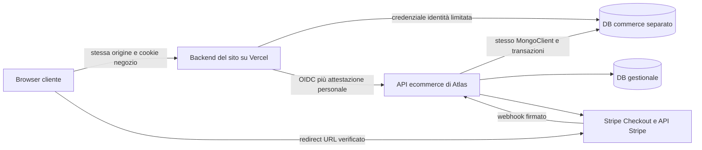

# Integrazione ecommerce del sito con Atlas

**Destinatario:** agente AI che gestisce il repository del sito esterno.  
**Mandato:** realizzare il collegamento e l’interfaccia del negozio nel sito, riusando il backend commerciale già predisposto in Atlas.  
**Versione del passaggio:** 5 novembre 2026, dopo il completamento del codice dei punti 2–13.  
**Ambienti concordati:** due nuovi progetti Vercel, Atlas di prova e sito di prova. Le env effettive, i collegamenti e il collaudo sugli ambienti sono gestiti dall’utente.

Il risultato richiesto è un sito con catalogo, registrazione, carrello, checkout online ospitato da Stripe, ordini personali e tracking. Prodotti, servizi, prezzi, Clienti, ordini, ricavi, lavorazioni e pubblicazioni partono da Atlas. Il sito presenta i dati e invoca le operazioni consentite, senza diventare un secondo gestionale.

Questo documento distingue **contratti già implementati in Atlas**, **moduli del pacchetto condiviso già disponibili** e **codice ancora da realizzare nel sito**. I percorsi delle route del sito indicati come mappatura sono la struttura da implementare, non la dichiarazione che esistano già nel repository del destinatario.

## Indice

- [1 Mandato e regole di lavoro](#1-mandato-e-regole-di-lavoro)
- [2 Materiale da trasferire](#2-materiale-da-trasferire)
- [3 Architettura e proprietà dei dati](#3-architettura-e-proprietà-dei-dati)
- [4 Ispezione iniziale del sito](#4-ispezione-iniziale-del-sito)
- [5 Installazione del pacchetto condiviso](#5-installazione-del-pacchetto-condiviso)
- [6 Ambienti e variabili](#6-ambienti-e-variabili)
- [7 Moduli server da predisporre](#7-moduli-server-da-predisporre)
- [8 Autenticazione del negozio](#8-autenticazione-del-negozio)
- [9 Collegamento commerciale ai Clienti](#9-collegamento-commerciale-ai-clienti)
- [10 Catalogo e vetrina](#10-catalogo-e-vetrina)
- [11 Canale personale verso Atlas](#11-canale-personale-verso-atlas)
- [12 Mappa delle route del sito](#12-mappa-delle-route-del-sito)
- [13 Carrello](#13-carrello)
- [14 Configurazione del checkout](#14-configurazione-del-checkout)
- [15 Riepilogo autorevole o quote](#15-riepilogo-autorevole-o-quote)
- [16 Conferma ordine](#16-conferma-ordine)
- [17 Pagamento ospitato](#17-pagamento-ospitato)
- [18 Elenco e dettaglio degli ordini](#18-elenco-e-dettaglio-degli-ordini)
- [19 Tracking e consegne](#19-tracking-e-consegne)
- [20 Errori e recupero delle operazioni](#20-errori-e-recupero-delle-operazioni)
- [21 Limiti e frequenza delle richieste](#21-limiti-e-frequenza-delle-richieste)
- [22 Interfacce da costruire](#22-interfacce-da-costruire)
- [23 Cache e dati personali](#23-cache-e-dati-personali)
- [24 Worker e responsabilità infrastrutturali](#24-worker-e-responsabilità-infrastrutturali)
- [25 Sequenza di implementazione](#25-sequenza-di-implementazione)
- [26 Matrice del collaudo](#26-matrice-del-collaudo)
- [27 Consegna finale dell’agente del sito](#27-consegna-finale-dellagente-del-sito)
- [28 Punti da coordinare con Atlas](#28-punti-da-coordinare-con-atlas)
- [29 Fonti tecniche e precedenza](#29-fonti-tecniche-e-precedenza)

## 1 Mandato e regole di lavoro

### 1.1 Decisioni già prese dall’utente

1. Atlas è il gestionale principale. Le anagrafiche Clienti e Articoli/Servizi esistono già.
2. Solo gli articoli e i servizi esplicitamente abilitati e pubblicati in Atlas vengono venduti online. Non si pubblica automaticamente tutta l’anagrafica.
3. Non è richiesta gestione di magazzino: nessuna giacenza, prenotazione di stock, decremento scorte o inventario da inventare nel sito.
4. Gli account del negozio sono separati dagli utenti del gestionale e dalle sessioni NextAuth Atlas. Non accedono all’interfaccia, alle API generiche, agli EVENTI o al calendario di Atlas.
5. L’account verificato viene collegato al Cliente commerciale da Atlas. Candidati ambigui richiedono verifica interna. Il browser non sceglie un Cliente esistente.
6. Il carrello diventa un riepilogo autorevole, poi un ordine aperto con ricavo programmato. La registrazione dell’incasso avviene soltanto dopo verifica del provider.
7. Sono richiesti solo pagamenti online. La soluzione implementata è Stripe Checkout ospitato, pagamento una tantum; PayPal è un metodo Stripe quando disponibile, Apple Pay/Google Pay sono wallet del metodo carta.
8. Non è implementato un secondo circuito PayPal diretto. Non aggiungerlo come fallback silenzioso.
9. Consegne e servizi si gestiscono dall’ordine in Atlas, con schede e veri EVENTI creati manualmente. Nessuna automazione di calendario deriva dal pagamento.
10. Il cliente vede solo fasi, consegne ed eventi selezionati e approvati dal personale. Le note interne non sono contenuti del sito.
11. La vetrina grafica appartiene al sito. Atlas configura contenuti, prezzo e pubblicazione della scheda; non impone al sito un layout del gestionale.
12. MongoDB evolve aggiungendo campi compatibili e collezioni. Non introdurre script di migrazione numerati, blocchi su versioni di schema o provisioning manuale a ogni aggiornamento. Atlas inizializza collezioni e indici mancanti.

### 1.2 Comportamento atteso dall’agente destinatario

Lavora nel repository del sito, rispetta le sue istruzioni e conserva design, componenti e contenuti esistenti. Non copiare l’intera applicazione Atlas. Non sostituire automaticamente il framework, non aggiornare dipendenze senza necessità e non costruire una seconda autenticazione incompatibile.

L’utente configura env e collegamenti e svolge il collaudo sui due progetti di prova. Prepara il codice senza richiedere segreti in chat e senza rendere l’assenza dei valori reali un ostacolo alle parti implementabili. Registra in un file le impostazioni mancanti e l’effetto concreto, per esempio “invio email non configurato”, invece di inserire valori fittizi che simulano successo.

Non effettuare deploy, scritture sui database reali, pagamenti/rimborsi, invii email o cambi ai ruoli Mongo per il solo fatto di aver ricevuto questo documento. Le attività già concordate in questa chat hanno escluso build, compilazione TypeScript e test applicativi eseguiti dall’agente Atlas: se il mandato dell’utente al destinatario non li autorizza, prepara la matrice di prova e lascia all’utente l’esecuzione. Distingui sempre codice predisposto, controllo statico e collaudo effettivo.

### 1.3 Cosa significa completare il punto 14

Devono esistere nel sito le route browser necessarie, i moduli server di collegamento, i form e le pagine del percorso completo. Le chiamate devono rispettare le API effettive qui descritte. Il risultato deve essere utilizzabile dopo configurazione degli ambienti e superamento del collaudo, senza spostare logica commerciale nel browser.

Non basta scrivere un piano, una vetrina con prodotti finti o pulsanti che non chiamano un servizio reale. Non basta nemmeno esporre un proxy universale verso Atlas.

## 2 Materiale da trasferire

### 2.1 Contenuto del passaggio

Il materiale da consegnare all’agente comprende:

- questo documento, `docs/ecommerce-handoff-agente-sito.md`;
- l’intera directory `packages/ecommerce-server`, inclusi `src`, dichiarazioni `.d.ts`, `examples`, `package.json`, README e `.env.example`;
- le guide `docs/ecommerce-*.md`, per verificare i singoli contratti;
- copie di consultazione dei contratti e degli handler Atlas in `reference/atlas`, nell’archivio trasferibile;
- `manifest-sha256.json` e `snapshot.json`, che identificano i file effettivamente trasferiti.

L’archivio è una copia dei file correnti del workspace. Molto codice e-commerce è ancora presente come modifica locale o file non tracciato: **un commit del repository remoto non identifica da solo questo stato**. Per lavorare sul medesimo contratto usa i file e gli hash dell’archivio, oppure una versione successiva esplicitamente fornita dall’utente.

### 2.2 Regole per l’archivio

`packages/ecommerce-server` è codice da installare nel sito. `reference/atlas` è materiale di consultazione: non copiarlo in `src/app` del sito e non importarlo nel suo runtime. Contiene riferimenti al gestionale, a capability staff e a percorsi non presenti nel sito.

Il pacchetto non è un SDK pubblico pubblicato su npm: è privato e si integra come dipendenza locale. Non eseguire `npm install @evolve/ecommerce-server` aspettandoti di scaricare da un registry la versione corretta.

Se ricevi solo questo documento senza il pacchetto, puoi impostare pagine e contratti locali, ma l’integrazione autenticata richiede il codice condiviso. Non ricostruire a memoria scrypt, CSRF, sessioni, attestazioni o OIDC. Chiedi il materiale mancante e continua le parti indipendenti.

## 3 Architettura e proprietà dei dati



### 3.1 Browser

Mostra dati, raccoglie form, presenta il consenso e chiama soltanto le route del sito. Non contiene credenziali Mongo, segreti Stripe/Resend, token OIDC, attestazioni firmate, chiavi HMAC o ID di un Cliente core. Non legge direttamente MongoDB. Non decide prezzi, IVA, proprietà degli ordini, stato del pagamento o stato reale della consegna.

### 3.2 Backend del sito

Gestisce gli account del negozio mediante il modulo condiviso. Ha una credenziale Mongo limitata alle collezioni di identità e ai metadati consentiti, e usa OIDC verso Atlas per le operazioni commerciali.

“Il sito non ha un database proprio” significa che non occorre creare un secondo archivio commerciale per il sito. **Il backend identità del sito si collega comunque al DB commerce condiviso** mediante una credenziale dedicata. Un sito esportato come soli file statici non può eseguire questo flusso senza aggiungere un backend server.

### 3.3 Atlas

Rimane autorevole per selezione prodotti, contenuti pubblicati, listino, configurazione IVA/consegna, Clienti, carrelli, quote, ordini, ricavi, pagamenti, rimborsi e lavorazione. Le API staff richiedono utenti staff correnti: non sono API da integrare nell’area cliente del sito.

### 3.4 Database e permessi

Il DB commerce è distinto dal DB gestionale, sullo stesso cluster MongoDB transazionale. Atlas usa un’unica connessione/client con `useDb` per coordinare transazioni fra i due DB. Il sito non riceve la URI del processore o la URI generale del gestionale.

Nel sito non eseguire CRUD diretto su carrelli, quote, ordini privati, Clienti, Ricavi, consegne o EVENTI. Anche catalogo e tracking vanno letti attraverso i loro reader Atlas, che verificano sorgente/pubblicazione e proprietà. Dal punto 13 la credenziale sito deve avere solo `listIndexes`, non `find`, su `commerce_tracking_views`. Il fatto che una credenziale precedente fosse più ampia non autorizza a usarla.

I ruoli effettivi sono configurati dall’utente. Il file Atlas `scripts/ecommerce/mongo-privileges.mjs` è un riferimento di privilegi, non uno script da lanciare per creare il negozio. Se i grant precedenti includono accessi rimossi, bisogna rimuoverli: aggiungere un ruolo ristretto non annulla un ruolo ampio ereditato.

## 4 Ispezione iniziale del sito

Prima di modificare il repository destinatario:

1. Leggi `AGENTS.md`, README, package manager e script esistenti.
2. Identifica framework/router, versioni Node e React, rendering server, modalità Vercel, middleware e regole di cache.
3. Verifica se esistono autenticazione, pagine account, route `/account`, carrello, analytics o service worker. I dati iniziali indicavano un sito senza DB e senza registrazione, ma il repository può essere evoluto.
4. Cerca collisioni con i percorsi previsti sotto, soprattutto `/account/ordini/[id]` e `/api/ecommerce/v1`.
5. Controlla alias `@/`, cartella `src`, runtime delle route e configurazione immagini.
6. Identifica il sistema grafico da riutilizzare. Non importare Common UI o componenti Atlas per copiare l’aspetto del gestionale.
7. Produci una mappa breve di file da aggiungere/modificare e funzioni già riutilizzabili.

Gli esempi sono per Next App Router. Se il sito usa un altro router/framework, conserva gli stessi metodi HTTP, cookie, controlli e payload traducendo solo l’adapter. Segnala differenze concrete che richiedano una modifica coordinata, senza inventare endpoint alternativi in Atlas.

## 5 Installazione del pacchetto condiviso

### 5.1 Dipendenze

Nel repository sito copia il pacchetto in `packages/ecommerce-server` e dichiara, adattando il manifest esistente:

```json
{
  "dependencies": {
    "@evolve/ecommerce-server": "file:packages/ecommerce-server",
    "@vercel/oidc": "^4.0.4",
    "mongoose": "^8.15.1"
  }
}
```

Il pacchetto richiede Node >=20 ed è JavaScript ESM con dichiarazioni TypeScript. Non necessita di compilazione separata per essere importato. Dipendenze proprie: `@vercel/oidc` `^4.0.4`, `jose` `^6.1.0`; Mongoose è peer. Non duplicare manualmente nel sito le implementazioni di queste librerie o le funzioni private di autenticazione.

Il sito dichiara anche `@vercel/oidc` come dipendenza diretta perché il nuovo trasporto commerciale importa `getVercelOidcToken` da quella libreria. Non affidarti al fatto che un package manager renda accessibili le dipendenze transitive. Mantieni disponibile il marker `server-only` secondo la configurazione del framework; se il progetto non lo dichiara e lo risolve tramite dipendenze transitive, aggiungilo esplicitamente.

Atlas usa Next 15.1.9/React 19; questo non impone di riscrivere il sito o di aggiornare automaticamente la sua versione di Next. Verifica la compatibilità del router e delle API del runtime presenti.

Aggiorna il lockfile con il package manager del sito nel perimetro autorizzato dall’utente. Non copiare `node_modules`, `.next`, l’intero `package.json` Atlas o il suo lockfile. Non usare `npm run dev` del gestionale: il relativo script avvia anche Mongo locale e appartiene a un altro progetto.

### 5.2 Esportazioni pubbliche disponibili

| Import                                 | Cosa offre realmente                                                                                                                            |
| -------------------------------------- | ----------------------------------------------------------------------------------------------------------------------------------------------- |
| `@evolve/ecommerce-server/auth`        | `createStorefrontAuth` e tipi account/principal                                                                                                 |
| `@evolve/ecommerce-server/client`      | `atlasCommerceClientFromEnv`, `createAtlasCommerceClient`, `probe`, catalogo, prodotto, pagina prodotto, collegamento Cliente e riconciliazione |
| `@evolve/ecommerce-server/catalog`     | Handler pubblici del catalogo e validatori dei relativi DTO                                                                                     |
| `@evolve/ecommerce-server/customers`   | Handler del collegamento commerciale e del worker privato                                                                                       |
| `@evolve/ecommerce-server/tracking`    | `createTrackingClient` e validatori/tipi dei tre DTO di tracking                                                                                |
| `@evolve/ecommerce-server/identity`    | Errori e risposte JSON uniformi; strumenti OIDC per il lato server                                                                              |
| `@evolve/ecommerce-server/persistence` | Connessione identità, descrizioni modelli e primitive generali; non è una licenza a fare CRUD commerciale nel sito                              |
| `@evolve/ecommerce-server/assertions`  | Verifica/hash delle prove personali; la firma di una richiesta cliente è orchestrata da `auth.prepareCommerceRequest`                           |

**Non esistono oggi metodi pubblici SDK chiamati `client.cart()`, `client.quote()`, `client.placeOrder()` o `client.startPayment()`.** Il loro trasporto nominativo deve essere scritto nel backend del sito usando i contratti e la preparazione dell’attestazione descritti sotto. Non scrivere esempi come se questi metodi esistessero già.

### 5.3 Template da copiare

| Sorgente nel pacchetto                                                           | Destinazione nel sito                                              |
| -------------------------------------------------------------------------------- | ------------------------------------------------------------------ |
| `examples/next-auth/server/storefront-auth.ts.example`                           | `src/server/storefront-auth.ts`                                    |
| `examples/next-auth/app/api/ecommerce/v1/auth/[action]/route.ts.example`         | Route auth omologa, togliendo `.example`                           |
| `examples/next-auth/app/api/ecommerce/v1/me/route.ts.example`                    | Route profilo omologa                                              |
| `examples/next-auth/app/api/internal/auth-mail/route.ts.example`                 | Worker privato sito                                                |
| `examples/next-auth/app/account/[action]/*`                                      | Pagine/form account da adattare al design, preservando i controlli |
| `examples/next-customers/server/storefront-customers.ts.example`                 | `src/server/storefront-customers.ts`                               |
| `examples/next-customers/app/api/ecommerce/v1/me/customer-link/route.ts.example` | Route omologa                                                      |
| `examples/next-customers/app/api/internal/customer-identities/route.ts.example`  | Worker privato sito                                                |
| `examples/next-customers/components/customer-link-status.tsx.example`            | Componente stato minimo da adattare                                |
| `examples/next-app/catalog/route.ts` e `[id]/route.ts`                           | `/api/ecommerce/v1/catalog` e dettaglio                            |
| `examples/next-app/product-pages/[slug]/route.ts`                                | `/api/ecommerce/v1/product-pages/[slug]`                           |

Gli esempi di catalogo hanno già estensione `.ts` ma risiedono nel pacchetto, non nell’albero route dell’app: non sono automaticamente distribuiti. Non trasformare tutti gli esempi in un’app secondaria separata.

## 6 Ambienti e variabili

### 6.1 Corrispondenze fra i due progetti

| Informazione        | Backend sito                                  | Atlas                                                            |
| ------------------- | --------------------------------------------- | ---------------------------------------------------------------- |
| Identità negozio    | `ECOMMERCE_SHOP_ID`                           | Stesso valore                                                    |
| Origine Atlas       | `ECOMMERCE_ATLAS_ORIGIN`                      | Origine del deployment Atlas                                     |
| Audience OIDC       | `ECOMMERCE_INTERNAL_AUDIENCE`                 | Stesso valore, uguale all’origine HTTPS Atlas                    |
| Origine sito        | `ECOMMERCE_STOREFRONT_ORIGIN`                 | `ECOMMERCE_ASSERTION_ISSUER`, stesso valore                      |
| Database commerce   | `ECOMMERCE_MONGODB_DB`                        | Stesso DB, diverso dal DB gestionale                             |
| URI identità        | `ECOMMERCE_MONGODB_URI`, credenziale limitata | Non va copiata come URI del processore                           |
| Trust del chiamante | Identità Vercel ottenuta al runtime           | Issuer, subject, progetto, owner e ambiente del sito autorizzato |

Origini HTTPS esatte, senza slash finale, path, query, credenziali nell’URL o wildcard. Non usare `VERCEL_URL` dinamico come ripiego per una configurazione mancante. Host preview multipli non diventano automaticamente origini autorizzate.

Un progetto chiamato “sito di prova” può avere un deployment Vercel classificato `production`. La claim JWT è quella reale del deployment, non il nome commerciale del progetto. Atlas distribuito come `production` rifiuta una policy che autorizzi preview/development. L’isolamento di prova dipende anche dagli ID dei due nuovi progetti e dai relativi DB/merchant, non dal solo testo “test”.

### 6.2 Env server del sito

La fonte trasferita è `packages/ecommerce-server/.env.example`. Nessun valore segreto va prefissato `NEXT_PUBLIC_`.

| Nome                                | Uso e formato                                                                                                     |
| ----------------------------------- | ----------------------------------------------------------------------------------------------------------------- |
| `ECOMMERCE_ATLAS_ORIGIN`            | Origine HTTPS Atlas esatta                                                                                        |
| `ECOMMERCE_INTERNAL_AUDIENCE`       | Stessa origine Atlas, audience dell’identità Vercel                                                               |
| `ECOMMERCE_ATLAS_PROTECTION_BYPASS` | Solo se serve per Deployment Protection Atlas; segreto server passato nell’header ufficiale, mai in query         |
| `ECOMMERCE_MONGODB_URI`             | Credenziale identità limitata sul DB commerce, senza fallback a `MONGODB_URI` generale                            |
| `ECOMMERCE_MONGODB_DB`              | Nome DB commerce del medesimo cluster usato da Atlas                                                              |
| `ECOMMERCE_SHOP_ID`                 | 1–80 caratteri alfanumerici, trattino o underscore; stabile e coerente con Atlas                                  |
| `ECOMMERCE_STOREFRONT_ORIGIN`       | Origine HTTPS sito esatta, anche per CSRF e link email                                                            |
| `ECOMMERCE_AUTH_HMAC_KEY`           | Chiave indipendente di 32 byte, base64url canonico di 43 caratteri; non uguale a segreti NextAuth, worker o email |
| `ECOMMERCE_AUTH_TERMS_VERSION`      | Versione dei testi realmente presentati alla registrazione                                                        |
| `ECOMMERCE_AUTH_PRIVACY_VERSION`    | Versione dell’informativa realmente presentata                                                                    |
| `ECOMMERCE_AUTH_EMAIL_KEY_ID`       | ID della chiave attiva per la coda email                                                                          |
| `ECOMMERCE_AUTH_EMAIL_KEYS`         | JSON con mappa ID→chiave base64url da 32 byte; massimo 5 chiavi, inclusa quella attiva                            |
| `ECOMMERCE_AUTH_RESEND_API_KEY`     | Chiave Resend dedicata al sito                                                                                    |
| `ECOMMERCE_AUTH_MAIL_FROM`          | Indirizzo mittente verificato, semplice email normalizzata; non un display name                                   |
| `ECOMMERCE_AUTH_DELIVERY_SECRET`    | Bearer privato per il worker email, 43–128 caratteri base64url                                                    |
| `ECOMMERCE_CUSTOMER_SYNC_SECRET`    | Bearer privato distinto per riconciliazione Clienti, 43–128 caratteri base64url                                   |

Esempio della forma del key ring, con valori da sostituire **solo nelle env dell’ambiente**:

```json
{
  "mail-key-1": "<chiave base64url canonica da 32 byte>"
}
```

Non copiare segreti fra i due progetti per comodità. Atlas non ha bisogno della chiave HMAC, del cookie sessione o delle chiavi email del sito. Il token OIDC non è un JWT statico da salvare nelle env: viene ottenuto dal contesto Vercel del backend.

Le stringhe pubbliche delle versioni termini/privacy possono essere passate come props ai form. Questo non autorizza a esportare l’intero oggetto env nel client.

### 6.3 Configurazioni che appartengono ad Atlas

Il collega che gestisce Atlas deve configurare `ECOMMERCE_OIDC_ISSUER`, `ECOMMERCE_SITE_SUBJECT`, `ECOMMERCE_SITE_PROJECT_ID`, `ECOMMERCE_SITE_OWNER_ID`, `ECOMMERCE_SITE_ENVIRONMENT`, audience e issuer delle attestazioni. Devono identificare il nuovo progetto sito di prova.

Restano solo in Atlas: URI del processore commerciale, DB gestionale, responsabile staff dei record, prefissi delle immagini pubbliche, chiavi Stripe, merchant ID, segreto webhook, metodi attivati e segreto del worker finanziario. Il sito non usa `ECOMMERCE_STRIPE_SECRET_KEY`, `ECOMMERCE_STRIPE_WEBHOOK_SECRET` o `ECOMMERCE_PAYMENTS_WORKER_SECRET`.

### 6.4 Avvio dell’ambiente

Prima di provare il login del sito, l’utente deve aprire una pagina dati E-commerce in Atlas con configurazione corretta: Atlas inizializza collezioni, guardie e indici. Il backend sito verifica gli indici e non ha permessi per crearli. `probe()` verifica l’identità del canale, non certifica disponibilità Mongo o configurazione del negozio.

L’autenticazione richiede HTTPS: cookie `Secure` e origine configurata non vanno indeboliti per rendere funzionante una prova HTTP locale. Usare gli ambienti HTTPS di prova concordati. La logica IP del pacchetto usa `x-vercel-forwarded-for` nel runtime Vercel; non sostituirla con un header IP scelto dal browser.

## 7 Moduli server da predisporre

Una struttura compatibile con Next App Router può essere:

```text
src/server/
  storefront-auth.ts
  storefront-catalog.ts
  storefront-customers.ts
  storefront-commerce.ts       # trasporto nominativo da implementare
  storefront-tracking.ts
  ecommerce-contracts.ts       # validatori pubblici mancanti, da implementare
  ecommerce-http.ts            # lettura body/risposte limitate, errori sicuri
src/app/api/ecommerce/v1/...
src/app/api/internal/auth-mail/route.ts
src/app/api/internal/customer-identities/route.ts
src/app/account/...
src/app/negozio/...
src/app/carrello/page.tsx
src/app/checkout/page.tsx
```

Tutti i moduli di collegamento iniziano con `import "server-only"`. Non importare questi moduli da componenti `"use client"`; separa eventuali `import type` dagli import runtime. Le esportazioni browser del pacchetto sono deliberatamente bloccate.

### 7.1 Identità del negozio

```ts
import "server-only";
import mongoose from "mongoose";
import { createStorefrontAuth } from "@evolve/ecommerce-server/auth";

export const storefrontAuth = createStorefrontAuth({
  mongoose,
  env: process.env,
});
```

La costruzione non apre il DB: la configurazione effettiva è usata all’arrivo delle richieste. Non sostituire questa connessione con la connessione generale di un’app Atlas.

### 7.2 Collegamento Cliente

```ts
import "server-only";
import { storefrontCustomerHandlersFromEnv } from "@evolve/ecommerce-server/customers";
import { storefrontAuth } from "./storefront-auth";

export const storefrontCustomers = storefrontCustomerHandlersFromEnv({
  auth: storefrontAuth,
  env: process.env,
});
```

### 7.3 Tracking

```ts
import "server-only";
import { createTrackingClient } from "@evolve/ecommerce-server/tracking";
import { storefrontAuth } from "./storefront-auth";

// Factory chiamata dentro il confine try/catch della richiesta:
export function trackingClient() {
  return createTrackingClient({ auth: storefrontAuth, env: process.env });
}
```

Questa factory valida le env quando viene chiamata. Non trasformare una env assente al build in un crash dell’import di tutte le pagine statiche. Gestisci gli errori alla richiesta con le risposte JSON uniformi del pacchetto.

## 8 Autenticazione del negozio

### 8.1 Route browser del sito

Base: `/api/ecommerce/v1`. Le route auth e profilo sono già implementate nel modulo condiviso; il sito deve montare gli adapter dei template.

| Metodo e percorso                | Body oppure risultato                                                    |
| -------------------------------- | ------------------------------------------------------------------------ |
| `GET /auth/csrf`                 | `{csrfToken}`, imposta il cookie nonce                                   |
| `POST /auth/register`            | `{email,password,name,kind,termsVersion,privacyVersion}`, `202` generico |
| `POST /auth/verify-email`        | `{token,password}`, nessun login automatico                              |
| `POST /auth/resend-verification` | `{email}`, `202` generico                                                |
| `POST /auth/login`               | `{email,password}` → `{account,csrfToken}` e cookie                      |
| `POST /auth/logout`              | `{}`, idempotente se la sessione è già assente                           |
| `POST /auth/logout-all`          | `{currentPassword}`                                                      |
| `POST /auth/forgot-password`     | `{email}`, `202` generico                                                |
| `POST /auth/reset-password`      | `{token,newPassword}`, nessun login automatico                           |
| `POST /auth/change-password`     | `{currentPassword,newPassword}`, poi logout                              |
| `POST /auth/change-email`        | `{email,currentPassword}`, `202` generico                                |
| `POST /auth/confirm-email`       | `{token,currentPassword}`, sessione dello stesso account, poi logout     |
| `GET /me`                        | `{account:{id,email,name,kind,phone?,emailVerified:true}}`               |
| `PATCH /me`                      | `{name?,phone?}`; almeno una modifica, telefono vuoto lo rimuove         |

`kind` è `individual` oppure `company`. Il profilo non permette al browser di modificare il tipo account o l’anagrafica Cliente core. Il suo `id` è un ID pubblico del negozio, non un ID da inviare come `principal.accountId`.

Usa form reali per termini e privacy, con i relativi testi raggiungibili. Non riutilizzare indiscriminatamente una versione legale di autenticazione come versione delle condizioni di acquisto: queste ultime arrivano dalla policy checkout.

### 8.2 Cookie e CSRF

Il modulo usa `__Host-storefront_session` e `__Host-storefront_csrf`, `Path=/`, `Secure`, `HttpOnly`. Sessione `SameSite=Lax`, nonce CSRF `SameSite=Strict`. Non aggiungere un attributo Domain, non spostare il cookie su Atlas e non creare una copia in localStorage.

Prima di ogni azione mutativa il browser recupera un CSRF aggiornato e lo invia in `X-Storefront-CSRF`, insieme al cookie automatico e a JSON. L’Origin deve coincidere con il sito configurato. Il cookie CSRF è HttpOnly: il valore da mettere nell’header arriva dal JSON di `/auth/csrf`, non da `document.cookie`.

```ts
const issued = await fetch("/api/ecommerce/v1/auth/csrf", {
  credentials: "same-origin",
  cache: "no-store",
  redirect: "error",
});
const { csrfToken } = await issued.json();
if (!issued.ok || typeof csrfToken !== "string") {
  throw new Error("Ricarica la pagina prima di riprovare.");
}

const result = await fetch("/api/ecommerce/v1/auth/login", {
  method: "POST",
  credentials: "same-origin",
  cache: "no-store",
  redirect: "error",
  headers: {
    "Content-Type": "application/json",
    "X-Storefront-CSRF": csrfToken,
  },
  body: JSON.stringify({ email, password }),
});
```

Controlla il risultato prima di leggere proprietà attese e non conservare password nello stato persistente, negli errori o nei log. Dopo login/cambio sessione, non riusare un CSRF legato alla sessione precedente.

### 8.3 Password e durata delle sessioni

Il modulo implementa scrypt Node, verifica delle password compromesse tramite Pwned Passwords, limiti persistenti, token monouso e revoche. Per nuove password richiede passphrase da 15 a 128 caratteri, con limiti di byte applicati sul server. Non replicare una politica diversa nel client: i controlli frontend possono anticipare quelli del server, senza sostituirli.

Durate implementate: inattività 30 minuti, durata assoluta 12 ore, CSRF 30 minuti, verifica email 24 ore, reset/cambio email 15 minuti. La pulizia TTL non determina la validità: il server verifica scadenze e revoche a ogni uso.

Se la verifica esterna delle password è indisponibile, non disattivarla per far passare la registrazione. Presenta l’errore temporaneo. Una registrazione o richiesta recupero con `202` non deve rivelare se l’email esista già o sia sospesa.

### 8.4 Link email e pagine account

I link usano il fragment, per esempio `/account/verify-email#token=...`. Non sono query `?token=...` e non devono consumare il token con una GET. Il form acquisisce il fragment in memoria, lo rimuove subito dall’URL con `history.replaceState` e richiede la conferma manuale prevista dall’azione.

Percorsi da preservare perché generati dalle email: `/account/verify-email`, `/account/reset-password`, `/account/confirm-email`. Gli altri percorsi del template sono `/account/register`, `/account/login`, `/account/forgot-password`, `/account/resend-verification`, `/account/change-password`, `/account/change-email`, `/account/logout`, `/account/logout-all`.

Escludi le pagine con token da analytics, tag manager, script terzi, registrazione delle sessioni, service worker, prefetch e cache. Imposta `Referrer-Policy: no-referrer` e robots noindex. Scanner di posta che aprono un link non devono eseguire la verifica o il reset.

## 9 Collegamento commerciale ai Clienti

Monta `GET/POST /api/ecommerce/v1/me/customer-link` usando `storefrontCustomers.handle(request)`.

- GET legge lo stato minimo per l’account corrente.
- POST, con CSRF e body `{}`, richiede una risoluzione consentita dal servizio; non accetta `accountId`, `customerId`, email arbitraria o decisioni staff.
- Risposta: `{status,checkoutReady,message}`.
- Stati: `pending`, `linked`, `review_required`, `blocked`.

Visualizza `message` come testo. Usa `checkoutReady` per guidare il percorso e bloccare la conferma quando necessario; l’autorizzazione finale resta in Atlas. Non creare direttamente un Cliente dal sito e non aggirare una revisione rendendo compilabile un ID core.

Verifica email e cambio identità producono segnali durevoli; il worker di riconciliazione li elabora. Il sito può mostrare “verifica commerciale in corso” e un’azione moderata di aggiornamento/riprova. Non lanciare un POST di risoluzione a ogni render.

Le aziende e le situazioni ambigue possono richiedere intervento interno. Non promettere un checkout immediato per ogni registrazione e non mostrare i candidati anagrafici del gestionale.

## 10 Catalogo e vetrina

### 10.1 API e adapter disponibili

Il catalogo browser è pubblico sul sito, ma il sito legge Atlas con OIDC. Monta i template:

| Sito                                                | Atlas chiamato dal server                          |
| --------------------------------------------------- | -------------------------------------------------- |
| `GET /api/ecommerce/v1/catalog?limit=20&cursor=...` | `GET /api/ecommerce/internal/catalog`              |
| `GET /api/ecommerce/v1/catalog/{id}`                | `GET /api/ecommerce/internal/catalog/{id}`         |
| `GET /api/ecommerce/v1/product-pages/{slug}`        | `GET /api/ecommerce/internal/product-pages/{slug}` |

`limit` predefinito 20, massimo 50. Il cursore è un ID pubblico restituito dalla lista. Parametri extra o duplicati sono rifiutati. Dettaglio prodotto/pagina non accettano query aggiuntive.

La factory da usare è `storefrontCatalogHandlersFromEnv(process.env)`. Gli handler ritardano la lettura delle env fino alla richiesta e sanitizzano gli errori.

### 10.2 DTO del prodotto

```ts
interface PublicCatalogProduct {
  id: string;
  slug: string;
  code: string;
  name: string;
  kind: "physical" | "service";
  description: string;
  revision: number;
  publishedAt: string;
  fulfillmentModes: ("shipping" | "pickup" | "service")[];
  image?: {
    id: string;
    url: string;
    alt: string;
    width: number;
    height: number;
  };
  price: {
    currency: "EUR";
    unitAmountCents: number;
    taxMode: "inclusive" | "exclusive";
    unitNetCents: number;
    unitTaxCents: number;
    unitGrossCents: number;
    taxRateBasisPoints: number;
  };
}
```

La lista restituisce `{items,nextCursor}`. La pagina prodotto aggiunge:

```ts
content: {
  title: string;
  summary: string;
  sections: {
    heading: string;
    text: string;
  }
  [];
  media: {
    id: string;
    url: string;
    alt: string;
    width: number;
    height: number;
  }
  [];
}
```

Questi tipi e i validatori sono esportati dal pacchetto. Usa `content` per comporre il layout del sito: testo semplice, sezioni e media. Non trasformare `text` in HTML eseguibile. Non esiste un renderer di pagine Atlas da montare nel sito.

### 10.3 Prezzi e IVA

Un prodotto può avere prezzo IVA inclusa e un altro IVA esclusa. Non assumere una modalità globale e non aggiungere sempre il 22%. `taxRateBasisPoints=2200` significa 22%, mentre `unitAmountCents` è il prezzo base nella modalità indicata.

Per l’utente finale mostra un prezzo coerente con la modalità e un’etichetta esplicita; la scelta editoriale B2C/B2B va concordata senza cambiare il calcolo del gestionale. I valori economici sono interi in centesimi: dividi per 100 solo per formattarli con `Intl.NumberFormat("it-IT", {style:"currency",currency:"EUR"})`.

Gli arrotondamenti autorevoli avvengono per riga. Per esempio 20,00 EUR IVA inclusa al 22% ha netto unitario arrotondato di 16,39 EUR; tre unità hanno netto di riga 49,18 EUR, non necessariamente 16,39×3=49,17. Non calcolare il totale ufficiale moltiplicando il netto unitario già arrotondato. Usa i totali della quote.

### 10.4 Pubblicazione e immagini

Letture Atlas rivalidano prodotto sorgente, abilitazione e pubblicazione. `404 PRODUCT_NOT_FOUND` può significare articolo ritirato o contenuti non più coerenti. Non tenere una copia locale del listino che continui a vendere il prodotto ritirato.

Le immagini arrivano solo da prefissi HTTPS di cartelle pubbliche autorizzate in Atlas. Se il sito usa un ottimizzatore immagini, configura solo i domini/percorsi necessari. Non costruire un proxy di download con URL arbitrari e non usare immagini private o URL firmati come catalogo pubblico.

Nessun numero di disponibilità o contatore stock deve essere dedotto dalla presenza del prodotto. La quantità nel carrello è quantità richiesta, non giacenza.

## 11 Canale personale verso Atlas

### 11.1 Due autenticazioni distinte

Ogni chiamata personale di carrello/quote/ordine/pagamento/tracking richiede:

1. OIDC Vercel del backend sito nell’header `Authorization`;
2. attestazione Ed25519 della sessione cliente nell’header `X-Commerce-Assertion`.

La sola identità del sito non basta a leggere un ordine cliente. La sola sessione cliente non basta a chiamare Atlas. Il token breve vincola account, sessione, versioni credenziali/accesso, negozio, metodo interno POST, percorso esatto e hash del body.

`storefrontAuth.prepareCommerceRequest(requestOriginale, pathAtlas, inputConsentito)` autentica la sessione e prepara `{payload,assertion}`. Non passargli un principal dal browser. Non inviare a mano il cookie a un’API Atlas. Non firmare un body e poi aggiungere/rimuovere campi prima della `fetch`.

### 11.2 Metodo browser e metodo interno

Le letture sono GET nel sito, ma POST con body firmato sul canale interno. Per il salvataggio carrello il browser usa PUT, mentre Atlas accetta POST. L’helper controlla il **metodo della Request browser originale**:

| Operazione                                                                        | Metodo della Request passata all’helper | Metodo della fetch ad Atlas |
| --------------------------------------------------------------------------------- | --------------------------------------- | --------------------------- |
| Carrello, opzioni, quote letta, lista/dettaglio ordine, stato pagamento, tracking | GET                                     | POST                        |
| Salvataggio carrello                                                              | PUT                                     | POST                        |
| Creazione quote, ordine e sessione pagamento                                      | POST                                    | POST                        |

Non ricostruire una Request cambiandone il metodo per aggirare il controllo. Non usare un POST browser per una lettura che l’helper ammette solo come GET.

### 11.3 Trasporto da scrivere per acquisto e ordini

Implementa un modulo privato con **sole operazioni nominate**: lettura/salvataggio carrello, opzioni checkout, creazione/lettura quote, creazione/lista/dettaglio ordine, avvio/stato pagamento. Le funzioni devono costruire i path da ID validati, non ricevere un URL da inoltrare dal browser.

Per ogni operazione:

1. La route del sito valida metodo, query e body in allowlist. Non accetta `principal`, `accountId`, `shopId`, prezzo, totali, stato ordine o URL di ritorno liberi.
2. Limita il body mentre lo legge; non fidarti solo di `Content-Length`. Per mutazioni mantieni JSON, Origin e CSRF originali, verificati dall’helper.
3. Chiama `prepareCommerceRequest` una volta per tentativo. Non fare una seconda autenticazione con rate limit se non serve: consumerebbe doppio budget.
4. Ottieni il token dal runtime con `getVercelOidcToken({audience})`, come i client del pacchetto.
5. Esegui POST all’origine Atlas fissa, `cache:"no-store"`, `redirect:"error"`, timeout finito. Invia solo Bearer OIDC, `Accept`, `Content-Type`, attestazione ed eventuale bypass Vercel configurato.
6. Il body è esattamente `JSON.stringify(prepared.payload)`.
7. Leggi la risposta con limite effettivo anche in streaming, verifica tipo JSON e applica il validatore dell’operazione. Limite operativo indicativo 1 MiB per i DTO personali; non lasciare letture illimitate.
8. Controlla corrispondenza con ordine/quote/ID richiesti dove la risposta li contiene. Non accettare una risposta relativa a un altro oggetto solo perché è JSON valido.
9. Restituisci al browser esclusivamente il DTO pubblico previsto, tramite `commerceJson`; sanitizza gli errori tramite `commerceErrorResponse` o un adapter equivalente.

Struttura del passaggio centrale, **schema da completare con validatori e mapping nominativi**, non helper già esportato:

```ts
const prepared = await storefrontAuth.prepareCommerceRequest(
  originalRequest,
  internalPathBuiltFromValidatedIds,
  allowlistedInput,
);
const oidc = await getVercelOidcToken({ audience: configuredAtlasOrigin });
const response = await fetch(
  new URL(internalPathBuiltFromValidatedIds, configuredAtlasOrigin),
  {
    method: "POST",
    cache: "no-store",
    redirect: "error",
    signal: AbortSignal.timeout(operationTimeoutMs),
    headers: {
      Authorization: `Bearer ${oidc}`,
      "Content-Type": "application/json",
      Accept: "application/json",
      "X-Commerce-Assertion": prepared.assertion,
      ...(configuredBypass
        ? { "x-vercel-protection-bypass": configuredBypass }
        : {}),
    },
    body: JSON.stringify(prepared.payload),
  },
);
// Da implementare: lettura limitata, status/error mapping chiuso,
// validazione esatta del DTO e corrispondenza con la richiesta.
```

Non inoltrare `request.headers` in blocco. In particolare non inoltrare `Cookie`, `Origin`, `X-Storefront-Session`, CSRF browser o Authorization ricevuto dal browser: il canale interno li rifiuta o non li usa. L’attestazione scade in 30 secondi; timeout e retry devono tenerne conto.

Le route Atlas di acquisto sono dichiarate con `maxDuration=30`; avvio pagamento ha `maxDuration=60`. Questi valori non garantiscono la durata concessa dal piano Vercel dell’utente. Scegli timeout finiti e un percorso di recupero dell’esito incerto; non prolungare a piacere la durata dell’attestazione.

### 11.4 Validatori da implementare nel sito

Catalogo e tracking hanno già validatori pubblici nel pacchetto. Per carrello, policy, quote, ordini e pagamenti il trasporto sito deve aggiungerli usando il contratto runtime riportato sotto e i file di consultazione Atlas.

Rifiuta campi extra e tipi inattesi, verifica ID pubblici, date ISO, interi sicuri, quantità e limiti di array, enum e valuta. Ricostruisci oggetti consentiti invece di fare `return response.json()` senza verifica. Gli errori interni sconosciuti devono diventare un messaggio generico, senza URI, stack, chiavi provider o query Mongo.

Le interfacce di consultazione `CartPreview` e `PublicQuote` non descrivono tutti i campi emessi a runtime: il carrello include anche `fulfillmentModes` nelle righe disponibili, e le righe quote includono `productPublicId` e `listingRevision`. **Per queste differenze usa le proiezioni runtime e l’elenco sotto, non inventare la rimozione dei campi sul servizio Atlas.**

## 12 Mappa delle route del sito

Base browser del sito: `/api/ecommerce/v1`. Base interna Atlas: `/api/ecommerce/internal`. Le righe seguenti sono la mappatura da montare nel sito.

| Route browser del sito                                      | Route Atlas                                 | Input commerciale senza principal                       |
| ----------------------------------------------------------- | ------------------------------------------- | ------------------------------------------------------- |
| `GET /cart`                                                 | `POST /cart`                                | `{}`                                                    |
| `PUT /cart/items`                                           | `POST /cart/items`                          | `{cartPublicId,expectedRevision,items}`                 |
| `GET /checkout-options`                                     | `POST /checkout-options`                    | `{}`                                                    |
| `POST /quotes`                                              | `POST /quotes`                              | Dati di cart/revisione, fatturazione, modalità e chiave |
| `GET /quotes/{id}`                                          | `POST /quotes/{id}`                         | `{}`                                                    |
| `POST /orders/place`                                        | `POST /orders/place`                        | `{quotePublicId,idempotencyKey}`                        |
| `GET /orders?cursor=...`                                    | `POST /orders`                              | `{cursor?}`                                             |
| `GET /orders/{id}`                                          | `POST /orders/{id}`                         | `{}`                                                    |
| `POST /orders/{id}/payment-session`                         | `POST /orders/{id}/payment-session`         | `{expectedRevision,idempotencyKey}`                     |
| `GET /orders/{id}/payment-status`                           | `POST /orders/{id}/payment-status`          | `{}`                                                    |
| `GET /orders/{id}/tracking`                                 | `POST /orders/{id}/tracking`                | `{}`                                                    |
| `GET /orders/{id}/timeline?cursor=...&deliveryPublicId=...` | `POST /orders/{id}/timeline`                | `{cursor?,deliveryPublicId?}`                           |
| `GET /orders/{id}/deliveries/{deliveryId}`                  | `POST /orders/{id}/deliveries/{deliveryId}` | `{}`                                                    |

Gli input delle GET vengono ricavati da query validate sul sito e diventano body firmato della POST interna. La POST interna non accetta query. Rifiuta parametri extra/duplicati e valida gli ID prima di comporre il path.

I path auth, profilo, collegamento Cliente e catalogo sono quelli delle sezioni precedenti. Non aggiungere al pubblico le API staff `/api/ecommerce/staff/*` o un proxy per `/api/anagrafiche`, `/api/eventi`, `/api/calendar`.

Per Next App Router: `runtime="nodejs"`, `dynamic="force-dynamic"` sulle route personali. Mantieni le risposte JSON `private, no-store`. Gli adapter di `route.ts` devono adattarsi alla versione Next presente nel sito, inclusa la forma asincrona dei params quando richiesta.

## 13 Carrello

### 13.1 Creazione e salvataggio

Il carrello autorevole è associato all’account verificato. Una prima versione può chiedere l’accesso prima di aggiungere al carrello. Non è implementato un guest checkout.

Il PUT browser invia l’intero insieme di righe desiderato, non una patch incrementale:

```json
{
  "cartPublicId": null,
  "expectedRevision": 0,
  "items": [
    {
      "productPublicId": "<id prodotto pubblicato>",
      "listingRevision": 4,
      "quantity": 2
    }
  ]
}
```

Per un carrello esistente usa il suo ID e l’ultima revisione ricevuta. Per rimuovere una riga, omettila dall’array; per svuotare, invia `items:[]`. Le quantità presenti sono interi da 1 a 1000, ulteriormente limitati dalla policy. Righe duplicate per prodotto non ammesse, massimo tecnico 98 righe prodotto prima dei possibili costi checkout.

Non inviare prezzo, nome, IVA, totale, Cliente, account o stock. La revisione listing arriva dal catalogo e deve essere confermata di nuovo quando cambia.

Un eventuale carrello ospite locale è soltanto un’ulteriore comodità UI da concordare: non è un carrello Atlas e non dà diritto ad acquistare. Non aggiungere in automatico fusione ospite/account senza trattare conflitti, revisioni e conferma dei prezzi.

### 13.2 Risposta runtime

Campi top-level: `id`, `revision`, `status`, `items`, `previewTotals`, `requiresReview`, `expiresAt`, eventuale `convertedOrderPublicId`.

- Carrello vuoto assente: `id:null`, `revision:0`, `status:"empty"`, array vuoto, totali/scadenza nulli.
- Righe: `productPublicId`, `listingRevision` anche `null` se legacy, `quantity`, `state`; quando disponibili, `currentListingRevision,title,code,kind,price,totals,fulfillmentModes`.
- Stati riga: `available`, `changed`, `unavailable`, `limit_exceeded`.
- `price`: `{unitMinor,taxMode,taxRateBps,currency}`.
- `totals`/`previewTotals`: `{netMinor,taxMinor,grossMinor,currency}`.
- Stato carrello: `active`, `expired`, `converted`, oltre a `empty` per assenza.

`requiresReview` impone un intervento esplicito: mostra quali prezzi/versioni sono cambiati, aggiorna il catalogo e salva le revisioni correnti solo dopo riconferma. Non mantenere nel checkout una riga diventata `unavailable`.

Il totale carrello è un’anteprima: costi della modalità di consegna e dati definitivi arrivano dalla quote. Non chiamarlo importo finale dovuto.

### 13.3 Concorrenza

Su `409 CART_CHANGED`, ricarica il carrello e mostra il conflitto con l’altra scheda/dispositivo. Non ritentare sovrascrivendo automaticamente il nuovo contenuto. Serializza i salvataggi sul client e impedisci doppio submit; una risposta vecchia non deve sovrascrivere lo stato di una richiesta più recente.

## 14 Configurazione del checkout

`GET /checkout-options` del sito legge la policy corrente da Atlas. Se il checkout non è configurato o è disabilitato, la risposta può essere `503 CHECKOUT_DISABLED`: non sostituirla con tariffe o termini inventati.

Risposta runtime:

```ts
{
  revision: number;
  termsVersion: string;
  countries: string[];
  maxLines: number;
  maxQuantity: number;
  maxGrossMinor: number;
  quoteTtlSeconds: number;
  requireIndividualTaxCode: boolean;
  requireCompanyVat: boolean;
  options: {
    publicId: string;
    mode: "shipping" | "pickup" | "service";
    label: string;
    details: string;
    countries: string[];
    price: {unitMinor:number;taxMode:"inclusive"|"exclusive";taxRateBps:number;currency:"EUR"};
    totals: {netMinor:number;taxMinor:number;grossMinor:number;currency:"EUR"};
  }[];
}
```

Non duplicare in codice le tariffe o i Paesi ammessi. Le modalità devono essere compatibili sia con le opzioni abilitate della policy sia con tutti i prodotti del carrello:

- prodotti fisici: una scelta fra spedizione e ritiro;
- servizi: una scelta servizio;
- carrello misto: una scelta fisica più una scelta servizio, massimo due;
- spedizione e ritiro insieme non sono ammessi per lo stesso ordine;
- indirizzo di spedizione obbligatorio solo se si è scelto `shipping`, e assente negli altri casi;
- destinazione ammessa dall’opzione: Paese spedizione per shipping, Paese fatturazione per pickup/service.

Mostra i campi fiscali richiesti dalla policy senza precompilare informazioni riservate del Cliente Atlas.

## 15 Riepilogo autorevole o quote

### 15.1 Creazione

La quote è un riepilogo immutabile con scadenza. Non è ancora l’ordine. Il sito invia:

```json
{
  "cartPublicId": "<id carrello>",
  "cartRevision": 3,
  "policyRevision": 2,
  "termsVersion": "<versione condizioni di acquisto dalla policy>",
  "idempotencyKey": "<chiave stabile di questa richiesta logica>",
  "billing": {
    "kind": "individual",
    "name": "<nome o ragione sociale coerente>",
    "email": "<email verificata del profilo>",
    "taxCode": "<quando richiesto>",
    "address": {
      "name": "<destinatario>",
      "line1": "<via e civico>",
      "city": "<città>",
      "postalCode": "<CAP>",
      "country": "IT"
    }
  },
  "shipping": {
    "name": "<destinatario spedizione>",
    "line1": "<via e civico>",
    "city": "<città>",
    "postalCode": "<CAP>",
    "country": "IT"
  },
  "fulfillmentSelections": [
    { "mode": "shipping", "optionPublicId": "<opzione attiva della policy>" }
  ]
}
```

Questo esempio rappresenta una spedizione di prodotti fisici; non inviare `shipping` quando non serve. I placeholder non sono dati validi da usare nei test.

Indirizzo: obbligatori `name,line1,city,postalCode,country`; opzionali `line2,region`. Fatturazione: opzionali `taxCode,vatNumber,recipientCode,certifiedEmail`, secondo profilo e policy. Evita di mandare campi sconosciuti, null o stringhe arbitrarie al posto di un oggetto opzionale assente.

Atlas verifica che `billing.kind` coincida col tipo profilo e `billing.email` con l’email verificata. Confronta anche nome/ragione sociale e gli identificativi fiscali già presenti nel Cliente collegato. `BILLING_REVIEW_REQUIRED` richiede assistenza interna, non un tentativo di modificare o leggere direttamente il Cliente dal sito.

### 15.2 Risposta della quote

La risposta è direttamente la quote pubblica, senza wrapper `quote` e senza polling di un’operazione asincrona:

```ts
{
  id: string;
  cartPublicId: string;
  cartRevision: number;
  policyRevision: number;
  termsVersion: string;
  createdAt: string;
  expiresAt: string;
  lines: {
    lineId:string;productPublicId:string;listingRevision:number;
    title:string;code:string;kind:"physical"|"service"|"delivery";
    quantity:number;price:PriceSnapshot;totals:MoneyTotals;
  }[];
  totals: MoneyTotals;
  billing: Billing;
  shipping?: Address;
  fulfillmentSelections: {
    optionPublicId:string;mode:"shipping"|"pickup"|"service";
    label:string;details:string;price:PriceSnapshot;
  }[];
}
```

`PriceSnapshot`, `MoneyTotals`, `Billing` e `Address` hanno le forme già descritte in questa guida. Le righe `delivery` sono costi autorevoli aggiunti dal backend; non diventano prodotti modificabili del carrello.

Mostra tutte le righe, modalità, fatturazione, indirizzi, imponibile, IVA e lordo dalla risposta. Richiedi conferma delle condizioni della policy e abilita l’azione d’ordine solo mentre la quote è valida. Un countdown client è un aiuto, non una proroga: il server rivalida sempre scadenza e contenuti.

`GET /quotes/{id}` sul sito rilegge una quote solo se ancora corrente per quell’account/carrello/policy/identità. Non è un archivio storico illimitato. Dopo conversione usa il dettaglio ordine.

### 15.3 Retry

Stessa richiesta logica, stessi dati, stessa `idempotencyKey`; nuova attestazione per ogni tentativo HTTP. Se cambiano carrello, fatturazione, modalità o condizioni, crea una nuova richiesta logica con nuova chiave. Non riusare la stessa chiave con payload diverso.

## 16 Conferma ordine

`POST /orders/place` browser invia esclusivamente:

```json
{
  "quotePublicId": "<id quote confermata>",
  "idempotencyKey": "<chiave stabile della conferma ordine>"
}
```

Non reinvia prezzi, righe, indirizzi, Customer ID o importi modificabili. Atlas li prende dalla quote validata.

Risposta effettiva `200`:

```ts
{
  order: CommerceOrder;
  replayed: boolean;
}
```

La transazione crea ordine aperto, ricavo programmato, associazioni, ricevuta, vista ordine, audit/outbox e consuma quote/carrello insieme. Il sito non deve fare una seconda chiamata “crea ricavo” o “crea Cliente”. Non attende una inbox o un operationId per questa operazione sincrona.

Se la rete cade dopo il commit, il risultato è incerto ma l’ordine può già esistere. Ritenta la stessa conferma con la stessa chiave e una nuova attestazione; Atlas restituisce lo stesso ordine quando riconosce la ricevuta. Non creare una nuova quote/chiave soltanto per superare il timeout e non avviare automaticamente una seconda vendita.

Una volta ricevuto l’ordine, passa alla sua pagina privata e all’avvio pagamento. Con la sola conferma non mostrare “Pagamento riuscito”: il ricavo è ancora programmato.

## 17 Pagamento ospitato

### 17.1 Avvio

Il browser POST su `/orders/{id}/payment-session` invia:

```json
{
  "expectedRevision": 0,
  "idempotencyKey": "<chiave stabile del tentativo logico>"
}
```

Usa la revisione corrente dell’ordine, non un numero fisso. Una revisione può cambiare per pagamenti, lavorazione o pubblicazione: su `ORDER_CHANGED` rileggi i dati e fai riconfermare l’azione, senza cambiare silenziosamente una richiesta già in corso.

La risposta cliente è:

```ts
{
  orderPublicId: string;
  orderRevision: number;
  paymentStatus: string;
  attempt: null | { id:string;state:string;expiresAt:string|null };
  paidMinor: number;
  refundedMinor: number;
  checkoutUrl: string | null;
}
```

Se `checkoutUrl` è presente e valido, esegui una navigazione top-level verso Stripe. Prima di usarlo, convalida nuovamente origine esatta `https://checkout.stripe.com`, assenza di credenziali e path che inizi con `/c/pay/`. Non usare `startsWith("https://checkout.stripe.com")`, che accetterebbe domini somiglianti, e non accettare URL dal body del browser.

Non incorporare un form carte, non aggiungere Stripe Elements o una raccolta di PAN/CVC. Questa integrazione usa il redirect al checkout ospitato, non un checkout embedded. Non serve una chiave Stripe segreta nel sito; l’attuale percorso non richiede nemmeno di creare sul sito una seconda Checkout Session.

### 17.2 Risposta senza URL

`checkoutUrl:null` è un caso valido: pagamento già ricevuto, tentativo in elaborazione, flusso non più pagabile o recupero pendente. Mostra lo stato e leggi `/payment-status`; non trattare automaticamente il valore nullo come un invito a creare un nuovo tentativo.

Una sessione chiusa ma in elaborazione può mantenere attivo il tentativo per impedire un secondo addebito. Un tentativo definitivamente fallito/scaduto può consentire una nuova azione esplicita con nuova chiave. In caso di esito incerto, conserva la chiave e non avviare retry rapidi automatici.

### 17.3 Ritorno al sito

Atlas costruisce questi URL sull’origine `ECOMMERCE_ASSERTION_ISSUER`:

```text
/account/ordini/{orderPublicId}?pagamento=ritorno
/account/ordini/{orderPublicId}?pagamento=interrotto
```

Preserva questi percorsi o concorda una modifica Atlas prima di cambiarli. Il parametro è presentazione, non autenticazione o prova di incasso. Anche `interrotto` non annulla l’ordine.

All’arrivo autentica l’account, verifica proprietà tramite l’API, leggi ordine e stato pagamento e mostra un’attesa se il webhook/worker non ha ancora riconciliato. Non usare `session_id`, valori della query o uno stato React persistente per segnare il ricavo pagato.

`GET /payment-status` restituisce la medesima forma senza avviare chiamate continue a Stripe e con URL normalmente nullo. Il pagamento viene aggiornato dal backend Atlas: leggere lo stato non sostituisce il worker finanziario.

### 17.4 Metodi e condizioni economiche

Il flusso è una tantum in EUR, importo supportato 0,50–999.999,99 EUR. Stripe riceve una riga “Ordine EC-…” con il lordo congelato, inclusi IVA e costi scelti. Non attivare nel sito sconti, quantità modificabili in Stripe, Stripe Tax, abbonamenti, cambio valuta o costi aggiuntivi che alterino questo importo.

PayPal compare solo se attivo e disponibile nel merchant Stripe; Apple Pay e Google Pay sono offerti quando disponibili nel contesto della carta, dispositivo e merchant. Non promettere sempre quattro pulsanti o una gratuità: disponibilità e commissioni effettive sono quelle del merchant configurato dall’utente. Il sito non abilita metodi alternativi modificando JSON del browser.

Webhook Stripe, chiavi, riconciliazione, rimborsi e rettifiche appartengono ad Atlas. Il sito non riceve webhook finanziari per registrare un secondo incasso e non espone un tasto rimborso collegato ad API staff.

## 18 Elenco e dettaglio degli ordini

`GET /orders` del sito inoltra un POST interno con `{principal,cursor?}`. Risposta `{items,nextCursor}`: massimo 30 ordini, ordinati dal più recente. Il cursore è un ID ordine pubblico restituito dalla risposta; non è un ID Mongo né una data costruita nel browser.

La lista contiene il riepilogo dell’ordine, non la riga staff con email/nome o riferimenti contabili interni. `GET /orders/{id}` restituisce direttamente l’ordine pubblico:

```ts
interface CommerceOrder {
  id: string;
  number: string;
  revision: number;
  placedAt: string;
  operationalStatus: string;
  paymentStatus: string;
  fulfillmentStatus: string;
  totals: MoneyTotals;
  payment?: {
    paidMinor: number;
    refundedMinor: number;
    paidAt?: string;
    method?: string;
    requiresReview: boolean;
  };
  lines: {
    lineId: string;
    productPublicId: string;
    listingRevision: number;
    title: string;
    code: string;
    kind: "physical" | "service" | "delivery";
    quantity: number;
    price: PriceSnapshot;
    totals: MoneyTotals;
  }[];
  billing: Billing;
  shipping?: Address;
  fulfillmentSelections: {
    optionPublicId: string;
    mode: string;
    label: string;
    details: string;
    price: PriceSnapshot;
  }[];
  fulfillment: {
    lineId: string;
    state: string;
    fulfilledQuantity: number;
    shippedQuantity: number;
  }[];
  termsVersion: string;
}
```

La lista usa il sottoinsieme `id,number,revision,placedAt,operationalStatus,paymentStatus,fulfillmentStatus,totals,payment?`.

Mostra separatamente i tre stati:

| Gruppo    | Codici                                                                                                     |
| --------- | ---------------------------------------------------------------------------------------------------------- |
| Operativo | `open,in_progress,on_hold,completed,cancelled`                                                             |
| Pagamento | `awaiting,processing,paid,refund_pending,partially_refunded,refunded,failed,expired,disputed,under_review` |
| Evasione  | `unfulfilled,in_progress,partial,fulfilled,cancelled`                                                      |

Non comprimere tutto in un booleano `paid` o `completed`. Un ordine annullato può aver ricevuto denaro tardivo da verificare; un ordine evaso può avere un rimborso; un ordine pagato può essere ancora da lavorare.

I controlli proprietà sono per account del negozio e negozio, non per Cliente commerciale. Se due account sono collegati allo stesso Cliente Atlas, non devono vedere gli ordini l’uno dell’altro. Non introdurre un filtro `customerId` nel sito per condividere ordini.

## 19 Tracking e consegne

Usa il client già implementato:

```ts
await trackingClient().tracking(originalRequest, orderId);
await trackingClient().timeline(originalRequest, orderId, {
  cursor,
  deliveryPublicId,
});
await trackingClient().delivery(originalRequest, orderId, deliveryId);
```

Passa la Request GET originale del browser. Per la prima pagina puoi omettere del tutto le opzioni; non inviare `cursor:null` quando il tipo richiede una stringa opzionale.

### 19.1 Riepilogo

Risposta disponibile:

```ts
{
  orderPublicId:string;
  status:"available";
  publicationVersion:number;
  publishedAt:string;
  phase:"open"|"in_progress"|"on_hold"|"completed"|"cancelled";
  fulfillmentStatus:"unfulfilled"|"in_progress"|"partial"|"fulfilled"|"cancelled";
  deliveries:PublicTrackingDelivery[];
  eventCount:number;
}
```

Consegna pubblica:

```ts
{
  publicId:string;label:string;mode:"shipping"|"pickup"|"service";
  phase:"planned"|"preparing"|"shipped"|"delivered"|"service_completed"|"cancelled";
  message?:string;expected?:PublicTrackingTime;shippedAt?:string;completedAt?:string;
  lines:{lineId:string;title:string;quantity:number}[];
}
```

### 19.2 Timeline

Risposta disponibile: campi base `orderPublicId,status,publicationVersion,publishedAt`, più `events,pageSize:20,nextCursor:string|null`.

Evento pubblico:

```ts
{
  publicId:string;deliveryPublicId:string;kind:"delivery"|"progress";
  title:string;text?:string;status:"planned"|"completed"|"cancelled";
  scheduled:PublicTrackingTime;occurredAt?:string;
}
```

Gli eventi arrivano già nell’ordinamento approvato: non ricostruirlo dai dati generici del calendario. Per una timeline di consegna passa il filtro `deliveryPublicId` della scheda visibile. Con il cursore successivo mantieni lo stesso filtro.

### 19.3 Dettaglio consegna

Risposta: campi base più `delivery` ed `eventCount` dei suoi eventi selezionati. Gli eventi si caricano dalla timeline filtrata, non sono implicitamente inclusi nel dettaglio. Non tentare una chiamata alle API EVENTI generiche per completarli.

### 19.4 Previsioni e date effettive

`PublicTrackingTime` è una delle tre forme:

```ts
{kind:"date",date:"2026-11-20",timeZone:"Europe/Rome"}
{kind:"instant",startsAt:"2026-11-20T09:00:00.000Z",timeZone:"Europe/Rome"}
{kind:"window",startsAt:"2026-11-20T09:00:00.000Z",endsAt:"2026-11-20T11:00:00.000Z",timeZone:"Europe/Rome"}
```

Una data senza ora va visualizzata come giorno italiano senza conversione che la sposti al giorno precedente. Istanti e finestre vanno formattati nel fuso dichiarato, mantenendo la distinzione visiva. Le date effettive sono `shippedAt`, `completedAt`, `occurredAt`: non dedurle dalla previsione e non segnare un evento programmato come concluso perché la data è nel passato.

### 19.5 Vista assente o ritirata

Per ordine proprio senza pubblicazione corrente, riepilogo e timeline non filtrata restituiscono:

```json
{ "orderPublicId": "<id ordine>", "status": "not_available" }
```

Non ci sono altri campi da mostrare. Rimuovi immediatamente dalla UI i contenuti precedenti e visualizza un messaggio neutro. Non ripiegare su una vecchia risposta in localStorage/cache, sulle bozze o sugli EVENTI interni.

Ordine altrui/inesistente: `404 TRACKING_NOT_FOUND`. Dettaglio e timeline filtrata usano lo stesso `404` per consegne non selezionate, non pubblicate o di altro ordine. Non mostrare messaggi che rivelino “esiste ma è di un altro account”.

`409 TRACKING_CHANGED` richiede di scartare cursore e pagine accumulate e ripartire dalla prima pagina. La versione di pubblicazione non è una revisione carrello e non va riutilizzata come `expectedRevision` di altre operazioni.

La pubblicazione può essere ritirata dopo una lettura già completata: una API non può cancellare ciò che il browser ha già ricevuto. L’applicazione deve evitare cache persistenti e rispettare gli aggiornamenti successivi.

## 20 Errori e recupero delle operazioni

Forma uniforme:

```json
{
  "error": {
    "code": "<codice previsto>",
    "message": "<messaggio sicuro>",
    "requestId": "<id diagnostico>"
  }
}
```

| Caso                                                                 | Comportamento sito                                                                                             |
| -------------------------------------------------------------------- | -------------------------------------------------------------------------------------------------------------- |
| Sessione assente/revocata/scaduta                                    | Rimuovi dati account dalla memoria, richiedi login e conserva solo una destinazione interna validata           |
| CSRF o Origin non validi                                             | Nessun bypass; recupera CSRF corrente o ricarica il form                                                       |
| `AUTH_RATE_LIMITED`, `TRACKING_RATE_LIMITED`                         | Mostra attesa, rispetta `Retry-After` se disponibile, blocca retry in loop                                     |
| `CUSTOMER_*` commerciale, `checkoutReady:false`                      | Stato neutro e verifica interna; nessun ID Cliente nel browser                                                 |
| `CART_CHANGED`                                                       | Rileggi carrello, mostra conflitto, evita sovrascrittura automatica                                            |
| `CATALOG_CHANGED`                                                    | Aggiorna prodotti/versioni, richiedi riconferma                                                                |
| `POLICY_CHANGED`, `DELIVERY_CHANGED`                                 | Rileggi policy e selezioni, genera una nuova quote dopo conferma                                               |
| `QUOTE_EXPIRED_OR_CHANGED`                                           | Ritorna al riepilogo e genera una nuova quote; non prorogare la vecchia                                        |
| `BILLING_INVALID`, `SHIPPING_INVALID`, `DELIVERY_INCOMPATIBLE`       | Evidenzia campi/modalità da correggere                                                                         |
| `BILLING_REVIEW_REQUIRED`                                            | Contatto assistenza/revisione, nessun aggiornamento diretto dell’anagrafica                                    |
| `IDEMPOTENCY_CONFLICT`                                               | Errore di stato locale da risolvere, non cambio casuale chiave in un retry                                     |
| `ORDER_CHANGED`                                                      | Rileggi ordine/revisione e fai riconfermare                                                                    |
| `ORDER_NOT_PAYABLE`, `PAYMENTS_DISABLED`, `PAYMENT_BUSY` o revisione | Mostra stato reale; attendi/rileggi o chiedi assistenza, senza un secondo addebito                             |
| Timeout dopo POST di conferma o pagamento                            | Esito incerto: non dire “non creato”; leggi stato e ritenta la stessa operazione logica con nuova attestazione |
| `REQUEST_REPLAY`                                                     | Una nuova chiamata deve generare una nuova attestazione; non riciclare il JWT precedente                       |
| `TRACKING_CHANGED`                                                   | Scarta cursore/pagine e riparti                                                                                |
| 404 di risorsa privata                                               | Messaggio identico per assente e non autorizzato                                                               |
| Errore OIDC/config/JSON inatteso                                     | Servizio temporaneamente indisponibile; diagnostica server senza segreti, niente stack al browser              |

### 20.1 Tre concetti da mantenere separati

| Elemento                                    | Durata e uso                                                                              |
| ------------------------------------------- | ----------------------------------------------------------------------------------------- |
| `idempotencyKey` commerciale                | Stabile per la stessa azione e gli stessi dati, anche dopo timeout                        |
| Attestazione cliente                        | Nuova per ogni tentativo HTTP, scadenza breve, nonce monouso                              |
| `expectedRevision` o revisioni quote/policy | Versione dei dati su cui l’utente sta agendo; aggiornare solo dopo rilettura e riconferma |

Usa chiavi casuali, per esempio UUID, per le azioni logiche. Non rigenerarle a ogni click/render o retry automatico. Non mantenere in localStorage sessioni, token email, attestazioni, URL Stripe, password o documenti personali. Se occorre persistere una chiave di recupero in modo minimo, separala dai dati sensibili e documenta scope per account/ordine, scadenza e pulizia al logout; preferisci recupero server e stato autorevole.

### 20.2 Destinazioni dopo login

Una destinazione `next`/`returnTo` deve essere un percorso interno autorizzato, non un URL arbitrario. Non introdurre un open redirect per riportare l’utente al carrello o all’ordine dopo il login. Il ritorno Stripe resta quello costruito da Atlas.

## 21 Limiti e frequenza delle richieste

### 21.1 Limiti effettivi del modulo identità

Il modulo condiviso applica attualmente:

| Gruppo              | Limiti principali                                                                                |
| ------------------- | ------------------------------------------------------------------------------------------------ |
| Invii email         | 200/ora globali, 20/ora per rete, 5/ora per identità                                             |
| Login               | 1000/5 minuti globali, 60/15 minuti per rete, 10/15 minuti per identità                          |
| Letture autenticate | 10000/5 minuti globali, 600/5 minuti per rete, 120/5 minuti per sessione                         |
| Altre azioni        | 2000/5 minuti globali; per nome azione 30/15 minuti per rete, 10/15 minuti per identità/sessione |
| Tracking Atlas      | Ulteriore budget 60/minuto per account/negozio, condiviso fra i tre endpoint e le sessioni       |

`prepareCommerceRequest` usa il gruppo `read` per letture e il nome azione **`checkout` per tutte le mutazioni commerciali**. Quindi salvataggi carrello, creazione quote, ordine e avvio pagamento condividono il budget identità di 10/15 minuti. È una condizione concreta del codice trasferito, da coordinare se l’esperienza richiede un limite diverso.

**Non implementare autosave a ogni tasto, debounce continuo delle quantità, POST di quote a ogni selezione o retry aggressivi.** Modifica localmente il form e salva esplicitamente il carrello; costruisci una quote soltanto quando l’utente procede. Se i limiti sono insufficienti per l’uso concordato, segnala la necessità di una revisione mirata sul modulo condiviso, con controlli equivalenti sui due progetti; non rimuoverli nel sito di nascosto.

### 21.2 Polling

Stato pagamento: una lettura iniziale e, se realmente pendente, polling moderato, per esempio ogni 15–30 secondi per una finestra limitata, poi aggiornamento manuale. È una scelta UI da calibrare rispettando i limiti combinati, non una promessa di tempo di conferma Stripe.

Non interrogare simultaneamente ordine, pagamento e tracking ogni secondo. Metti in pausa in background, interrompi al logout/errore definitivo, cancella richieste obsolete e usa un backoff sui 429/503. Per il tracking privilegia caricamento alla visita, cambio pagina/filtro e aggiornamento esplicito.

Un errore nell’autenticazione o una vista ritirata deve svuotare gli stati visualizzati, non lasciare l’ultima risposta come se fosse attuale.

## 22 Interfacce da costruire

### 22.1 Vetrina e pagina prodotto

Mantieni navigazione e design del sito. Prevedi lista paginata, dettaglio per slug, media autorizzati, testo semplice, prezzo/IVA espliciti, modalità compatibili e CTA di acquisto. Gestisci caricamento, catalogo vuoto, prodotto ritirato, errore servizio e assenza immagini senza sostituire i dati con prodotti finti.

Il sito può collegare una sua pagina editoriale al prodotto tramite ID pubblico o slug configurato in Atlas. Non duplicare prezzo e stato vendibile nel codice della pagina. Non pubblicare tutta l’anagrafica.

### 22.2 Account

Registrazione, verifica email, login, recupero, reset, cambi credenziali, profilo e logout. Mostra il collegamento commerciale minimo con gli stati previsti. Non presentare ruoli Atlas, password staff o accessi al gestionale.

Le pagine auth con link devono chiedere la conferma prevista; i messaggi di registrazione/recupero restano generici. I form devono essere accessibili, con label, errori associati, messaggi `role="status"/"alert"`, gestione del focus e submit disabilitato durante la richiesta.

### 22.3 Carrello

Quantità editabili entro policy, rimozione e salvataggio esplicito, stato prodotti/versioni, anteprima totali, messaggi di conflitto e CTA verso checkout. Nessun indicatore stock inventato. Non nascondere le variazioni di prezzo riconfermandole automaticamente.

### 22.4 Checkout

Dati fatturazione dal profilo verificato e dal form, tipo account coerente, campi fiscali condizionati dalla policy, indirizzo spedizione solo dove richiesto, scelta modalità e riepilogo finale autorevole. Non chiedere dati carta. Distinguere “Conferma ordine” dall’esito del successivo pagamento online; l’ordine rimane aperto se il cliente interrompe il checkout Stripe.

### 22.5 Area ordini

`/account/ordini` con lista propria, paginazione, importi e stati separati. `/account/ordini/[id]` con dati storici, pagamento/rimborsi, righe, modalità, azione di pagamento se il server la ammette e tracking approvato. Mantieni i percorsi di ritorno Stripe indicati.

### 22.6 Tracking

Riepilogo fasi, schede parziali e date, timeline paginata, filtro/dettaglio consegna. L’assenza di dati approvati è uno stato normale. Non mostrare un calendario gestionale, nomi degli operatori o note interne.

## 23 Cache e dati personali

Nella prima integrazione usa `no-store` e route dinamiche per il catalogo, le API personali e gli adapter. Non introdurre ISR/CDN per prezzi e stato vendibile senza un progetto di invalidazione coerente con Atlas: la sorgente viene rivalidata a ogni lettura.

Per account, carrello, quote, ordini, pagamenti e tracking:

- risposte `Cache-Control: private, no-store`;
- niente prerender statico con dati di un account;
- niente cache server globale indicizzata solo per URL quando la risposta dipende dal cookie;
- niente service worker che salvi risposte API o pagine personali;
- pulizia di store e query cache al logout/cambio account;
- abort o scarto delle risposte di richieste partite prima di un logout/cambio account;
- nessun `dangerouslySetInnerHTML` per testo proveniente dai DTO;
- niente analytics con email, indirizzi, token, query/fragment sensibili o URL Stripe.

I log server possono contenere nome operazione, codice errore e requestId; non body di login, cookie, Authorization, attestazioni, chiavi, payload email decifrati o dati carta. Non mandare i body delle API a servizi di session replay.

Le pagine pubbliche possono avere SEO basato su contenuti pubblicati, ma una pagina SEO non deve congelare un prezzo o un articolo ritirato. Non dedurre `InStock` da un sistema che non gestisce scorte.

## 24 Worker e responsabilità infrastrutturali

### 24.1 Worker email nel sito

Route template: `POST /api/internal/auth-mail`, Bearer `ECOMMERCE_AUTH_DELIVERY_SECRET`, nessuna Origin browser. Handler `storefrontAuth.handleMailDelivery(request)`. Il worker legge e decifra la coda e usa Resend; registrazione e reset non inviano sincronicamente l’email.

Il worker processa normalmente fino a 5 consegne per invocazione, con lease/retry. Le consegne hanno una finestra di invio di 15 minuti e pulizia dopo 7 giorni: senza invocazioni regolari non arrivano le verifiche, anche se l’API registra la richiesta. L’utente deve configurare il chiamante privato e una frequenza adeguata prima di collaudare il percorso email.

Non aggiungere un pulsante pubblico “esegui worker” e non invocarlo dal browser dopo la registrazione. Non assumere che un cron nativo GET chiami automaticamente una route POST: predisporre un invocatore compatibile e autenticato, o una soluzione infrastrutturale concordata. Nessun segreto nella query del cron.

### 24.2 Worker Clienti nel sito

Route template: `POST /api/internal/customer-identities`, Bearer `ECOMMERCE_CUSTOMER_SYNC_SECRET`, senza Origin o Cookie. Handler `storefrontCustomers.handleReconciliation(request)`, che chiama il servizio Atlas con OIDC. La risposta contiene solo conteggi `planned,processed,deferred,failed`.

Questo worker assicura continuità dopo verifica/cambio identità; non permette al browser di fornire una lista di Clienti da associare. Non inviare questi risultati operativi all’area cliente come dati commerciali.

### 24.3 Pagamenti in Atlas

Webhook: `/api/ecommerce/webhooks/stripe`, raggiungibile da Stripe secondo configurazione di Deployment Protection dell’utente. Worker: POST `/api/ecommerce/internal/payment-jobs` con `ECOMMERCE_PAYMENTS_WORKER_SECRET`, nell’ambiente Atlas. La semplice ricezione del webhook salva il lavoro durevole; il worker ne riconcilia gli effetti.

Il sito deve sapere se questi collegamenti sono configurati per interpretare un pagamento pendente, ma non possiede i relativi segreti e non sostituisce il worker con polling continuo di Stripe. Non creare un terzo deployment per questi worker: l’assetto concordato resta due progetti.

### 24.4 Prerequisiti Atlas da chiedere come stato

Per il collaudo l’utente deve aver predisposto: trust del progetto sito, DB/indici/ruoli, account responsabile dei record, catalogo abilitato/pubblicato, mappature ricavi, policy checkout e modalità/Paesi, versioni delle condizioni, merchant Stripe di prova e metodi effettivi, webhook e worker.

Chiedere “il checkout è configurato?” è diverso da chiedere chiavi in chat. Raccogli solo lo stato necessario; i valori sensibili restano nelle env gestite dall’utente.

## 25 Sequenza di implementazione

| Passaggio | Lavoro nel sito                             | Risultato verificabile senza fingere connessioni                      |
| --------- | ------------------------------------------- | --------------------------------------------------------------------- |
| 1         | Ispezione framework, router, cache e design | Mappa dei file, collisioni e istruzioni repository                    |
| 2         | Trasferimento pacchetto e dipendenze locali | Import server coerenti e manifest/lockfile del sito preparati         |
| 3         | Moduli server e adapter catalogo            | Route nominate e pagine vetrina collegate al contratto pubblico       |
| 4         | Auth, profilo, form e pagine link           | Adapter dei template e controlli cookie/CSRF preservati               |
| 5         | Worker privati e collegamento Cliente       | Route private protette e stato commerciale minimo in UI               |
| 6         | DTO e trasporto personale nominativo        | Nessun URL/proxy libero, prove da Request originale, letture limitate |
| 7         | Carrello                                    | GET/PUT, revisioni, salvataggio esplicito, variazioni da riconfermare |
| 8         | Policy e quote                              | Form compatibile, calcoli autorevoli, scadenze e chiavi stabili       |
| 9         | Ordine e dettaglio                          | Conferma idempotente, archivio proprio e pagina privata coerente      |
| 10        | Pagamento ospitato e ritorno                | URL Stripe verificato, stati pendenti e recupero senza duplicazioni   |
| 11        | Tracking                                    | Client condiviso, pagination/filtro, vista ritirata rimossa dalla UI  |
| 12        | Controllo cache, errori e accessibilità     | Nessuna fuga di dati account o token, stati vuoti/errore completi     |
| 13        | Documentazione ambiente e matrice di prova  | Prerequisiti mancanti, test e responsabilità dell’utente espliciti    |

Non distribuire automaticamente un ambiente o lanciare pagamenti reali per chiudere una voce. Non considerare l’interfaccia “verificata end-to-end” perché compila o perché una risposta mock ha la forma prevista.

## 26 Matrice del collaudo

Questi scenari vanno preparati per l’esecuzione autorizzata dall’utente sui due progetti di prova. Se usi fixture per il solo sviluppo UI, rendile esplicite e non attive come fallback in caso di errore del servizio.

| Area         | Scenario                                            | Risultato atteso                                                     |
| ------------ | --------------------------------------------------- | -------------------------------------------------------------------- |
| Separazione  | Credenziali negozio sul login Atlas                 | Nessun accesso al gestionale                                         |
| Segreti      | Ispezione bundle client, HTML e log                 | Nessuna URI, chiave, cookie, JWT o attestazione                      |
| OIDC         | Progetto/owner/ambiente/audience errati             | Chiamata rifiutata, errore sicuro                                    |
| Canale       | Cookie o Origin inoltrati ad Atlas                  | Rifiuto; il trasporto corretto non li invia                          |
| Avvio        | Env/indici non pronti                               | Indisponibilità esplicita, nessun successo simulato                  |
| Auth         | Registrazione/verifica/login                        | Conferma manuale e cookie; nessun User Atlas                         |
| Auth         | Email già esistente o sospesa                       | Risposta generica senza enumerazione                                 |
| Auth         | Link scaduto/riusato, scanner GET                   | Nessun consumo improprio o login automatico                          |
| Auth         | CSRF mancante/vecchio e Origin esterna              | Mutazione rifiutata                                                  |
| Auth         | Logout, reset, cambio password/email                | Sessioni revocate e stati UI ripuliti                                |
| Auth         | Due account sulla stessa email staff                | Archivi e permessi indipendenti                                      |
| Clienti      | Privato univoco, azienda e ambiguità                | CheckoutReady coerente; nessun elenco candidati nel sito             |
| Email        | Worker fermo o Resend irraggiungibile               | Stato gestito; nessun token mostrato nei log                         |
| Catalogo     | Abilitazione/pubblicazione/ritiro                   | Solo dati correnti, nessun listino locale che continua a vendere     |
| Catalogo     | Slug ignoto, query duplicata, media assente         | 404/400 corretti e UI gestita                                        |
| IVA          | Prezzi inclusi/esclusi e righe miste                | Totali uguali alla quote, nessun ricalcolo ufficiale browser         |
| Carrello     | Quantità/rimozione/svuotamento                      | Payload sostitutivo e revisioni corrette                             |
| Carrello     | Due schede modificano insieme                       | Conflitto visibile, nessuna sovrascrittura cieca                     |
| Carrello     | Prodotto ritirato o revisione cambiata              | Rimozione o riconferma esplicita                                     |
| Checkout     | Policy disabilitata o Paese non ammesso             | Nessuna tariffa/condizione inventata                                 |
| Checkout     | Fisico, servizio e ordine misto                     | Modalità compatibili, shipping solo quando richiesto                 |
| Fatturazione | Tipo/email/nome/fiscali discordanti                 | Correzione o revisione interna, nessuna modifica Cliente dal browser |
| Quote        | Scadenza, cambio policy/catalogo/account            | Nuova quote richiesta, vecchia non prorogata                         |
| Idempotenza  | Doppio click e timeout dopo commit ordine           | Un ordine e un ricavo, stessa chiave nei retry                       |
| Idempotenza  | Stessa chiave con body differente                   | 409, niente cambio chiave automatico                                 |
| Attestazioni | Riuso JWT o cambio path/body                        | Rifiuto; ogni tentativo prepara una nuova prova                      |
| Pagamento    | Ritorno query falsificato                           | Nessuna conferma di incasso dal browser                              |
| Pagamento    | Checkout interrotto/browser chiuso                  | Ordine non annullato automaticamente                                 |
| Pagamento    | Timeout, stato pendente, nuovo tentativo            | Recupero senza creare una seconda vendita/addebito                   |
| Pagamento    | Metodo PayPal/wallet indisponibile                  | Nessuna promessa falsa o circuito alternativo automatico             |
| Pagamento    | URL Stripe non conforme                             | Nessuna navigazione esterna arbitraria                               |
| Ordini       | ID ordine altrui o stesso Cliente di altro account  | Nessuna lettura, 404 uniforme                                        |
| Tracking     | Selezione pubblicata e non selezionata              | Solo DTO approvato                                                   |
| Tracking     | Ritiro o modifica in Atlas                          | Vecchi contenuti rimossi al refresh, nessun fallback a cache         |
| Tracking     | Cursore vecchio/cambio filtro                       | Ripartenza dalla prima pagina senza mescolare versioni               |
| Tracking     | Consegna di altro ordine/non pubblicata             | 404 uniforme                                                         |
| Tracking     | Data, istante, finestra e cambio d’ora              | Visualizzazione italiana corretta, previsione distinta da effettivo  |
| Limiti       | Salvataggi ripetuti, polling e 429                  | Attesa/backoff, nessun loop o disattivazione dei limiti              |
| Cache        | Logout e login di altro utente nello stesso browser | Nessun dato dell’utente precedente                                   |
| UI           | Mobile, tastiera, errori e caricamento              | Nessun blocco del percorso o azione duplicata                        |

Le prove di concorrenza/rollback fra ordini, ricavi e pagamenti appartengono anche al collaudo Atlas. Il destinatario deve cooperare sugli scenari senza riscrivere quelle transazioni nel sito.

## 27 Consegna finale dell’agente del sito

Alla fine fornisci all’utente:

1. elenco dei percorsi e delle pagine realizzati, separando browser, chiamate Atlas e worker;
2. file modificati e riepilogo dei moduli riusati dal pacchetto;
3. env richieste per il sito con soli nomi/formati, senza valori;
4. informazioni da coordinare con Atlas, inclusi dominio, progetto e claim effettive;
5. stato di configurazione di email, riconciliazione Clienti e pagamenti come prerequisiti, non come segreti;
6. verifiche statiche realmente eseguite ed eventuali controlli runtime autorizzati, con risultati;
7. scenari ancora da eseguire dall’utente, anomalie note e loro impatto;
8. conferma che non sono state montate interfaccia/route staff Atlas nel sito;
9. conferma che nessun contenuto mock o bypass auth è rimasto attivo nel percorso reale;
10. istruzioni brevi per seguire una vendita di prova dall’account al tracking.

Se una API effettiva non copre una necessità UI, descrivi richiesta, payload minimo, autorizzazione e problema concreto da sottoporre all’agente Atlas. Non creare un accesso Mongo commerciale per aggirarla.

## 28 Punti da coordinare con Atlas

Sono già disponibili i contratti di base. Restano da conoscere/configurare nell’ambiente dell’utente:

- repository, framework e domini effettivi del sito;
- ID e ambiente Vercel dei due nuovi progetti, con trust OIDC coerente;
- credenziali Mongo realmente limitate e indici inizializzati;
- merchant di prova, metodi effettivi, webhook e invocazioni worker;
- versioni e testi reali delle informative e delle condizioni checkout;
- Paesi, opzioni e tariffe configurate in Atlas;
- eventuale adeguamento mirato dei limiti `checkout` rispetto al flusso UI desiderato;
- richieste di dati aggiuntivi non presenti nei DTO, per esempio nuove preferenze profilo o messaggi di supporto.

Questi punti non richiedono di inventare nuovi schemi o migrazioni. Non modificare il contratto di registrazione per trasformare l’account cliente in un utente staff, né utilizzare la stessa password per impersonare il cliente nel gestionale.

## 29 Fonti tecniche e precedenza

### 29.1 Guide trasferite

- [Catalogo e vetrina](ecommerce-catalogo-vetrina.md)
- [Account del negozio](ecommerce-account-negozio.md)
- [Collegamento ai Clienti](ecommerce-collegamento-clienti.md)
- [Carrello e riepilogo](ecommerce-carrello-riepilogo.md)
- [Ordine e ricavo](ecommerce-ordini-ricavi.md)
- [Stripe ospitato](ecommerce-pagamenti-stripe.md)
- [Consegne ed EVENTI](ecommerce-consegne-eventi.md)
- [Fasi e pubblicazione dall’ordine](ecommerce-gestione-ordine.md)
- [API personali di tracking](ecommerce-tracking-api.md)
- [Persistenza e privilegi](ecommerce-modelli-transazioni.md)
- [Piano e stato dei passi](ecommerce-piano-attivita.md)
- [Pacchetto server](../packages/ecommerce-server/README.md)

### 29.2 Sorgenti da consultare

Nel pacchetto: `src/auth.js`, `src/auth/security.js`, `src/auth/runtime.js`, `src/auth/mail.js`, `src/auth.d.ts`, `src/catalog.d.ts`, `src/catalog-contract.js`, `src/catalog.js`, `src/customers.js`, `src/customers.d.ts`, `src/client.js`, `src/assertions.js`, `src/tracking.d.ts`, `src/tracking-client.js`, `src/tracking-contract.js` e `examples`.

Nel materiale di riferimento Atlas: gli handler interni di checkout/ordini/pagamenti/tracking, `checkout/validation.ts`, `checkout/policy.ts`, proiezioni pubbliche nei rispettivi `service.ts`, tipi di consultazione, `fulfillments/publication.ts`, schema delle viste condivise, middleware e riferimento privilegi Mongo.

In caso di contrasto fra un esempio progettuale vecchio e il codice trasferito, non inventare un terzo comportamento: consulta l’handler effettivo e la guida del passo più recente e registra la differenza. Le API del personale e le route ipotetiche dei primi documenti non sono automaticamente contratti pubblici del sito.

Le versioni e le impostazioni di librerie citate qui identificano il codice trasferito. Non costituiscono una verifica corrente di piani, prezzi, commissioni o disponibilità dei servizi esterni. Per questa integrazione preserva il contratto già scritto; aggiornamenti di SDK, API Stripe o trust infrastrutturale richiedono una verifica coordinata distinta.
